# Reading List Knowledge Graph & Taxonomy Index

- **Documents Indexed:** 16
- **Semantic Chunks:** 47
- **Knowledge Graph Nodes:** 186
- **Knowledge Graph Edges:** 1126

## 1. Indexed Documents & Tracking Status

| ID | Status | Priority | Type | Title | Published | Links |
|---|---|---|---|---|---|---|
| `semieng-2026-bare-ai-monitors` | `read` | `high` | `technical_article` | [On-Chip Monitors Detect Bit-Flip Attacks in AI Accelerators (UF, UT Dallas, RPI)](https://semiengineering.com/on-chip-monitors-detect-bit-flip-attacks-in-ai-accelerators-uf-ut-dallas-rpi/) | 2026-10 | `REPORTS_ON` -> `arxiv-2610.08739v2` |
| `arxiv-2610.08739v2` | `reading` | `high` | `academic_paper` | [BARE-AI: Bit-Flip Attack Resilience in AI Hardware through Built-in Performance Monitors](https://arxiv.org/abs/2610.08739v2) | 2026-10-06 | — |
| `arxiv-2610.33748` | `reading` | `high` | `academic_paper` | [A Rowhammer attack on Fil-C's software capabilities](https://arxiv.org/abs/2610.33748) | 2026-10 | — |
| `techpaper-2026-hbm-chiplet-resilience` | `to-read` | `medium` | `technical_paper` | [Cross-Layer Resilience for HBM and UCIe Chiplet AI Accelerators Under Targeted Bit-Flip Faults](https://semiengineering.com/) | 2026-10 | `CITES` -> `arxiv-2610.08739v2`, `CITES` -> `arxiv-2610.33748` |
| `techpaper-2026-eda-formal-monitors` | `to-read` | `medium` | `technical_paper` | [Pre-Silicon Formal Verification of On-Chip Telemetry Monitors Against Fault Injection](https://arxiv.org/abs/2610.08739v2) | 2026-11 | `CITES` -> `arxiv-2610.08739v2`, `CITES` -> `arxiv-2610.33748` |
| `note-2026-cross-layer-bitflip-synthesis` | `read` | `high` | `note` | [Synthesis Note: Cross-Layer Bit-Flip Resilience Across AI Accelerators and Capability Runtimes](https://github.com/bsommers/reading-db) | 2026-11-05 | `CITES` -> `arxiv-2610.08739v2`, `CITES` -> `arxiv-2610.33748`, `CITES` -> `semieng-2026-bare-ai-monitors` |
| `arxiv-2208.03699` | `read` | `high` | `academic_paper` | [UCLID5: Multi-Modal Formal Modeling, Verification, and Synthesis](https://arxiv.org/abs/2208.03699) | 2022-08-06 | — |
| `arxiv-2503.19174` | `reading` | `high` | `academic_paper` | [AssertionForge: Enhancing Formal Verification Assertion Generation with Structured Representation of Specifications and RTL](https://arxiv.org/abs/2503.19174) | 2025-03-24 | `CITES` -> `arxiv-2208.03699` |
| `arxiv-2604.23100` | `to-read` | `high` | `academic_paper` | [ProofLoop: From Language to Logic — Bridging LLMs and Formal Representations for RTL Assertion Generation](https://arxiv.org/abs/2604.23100) | 2026-04-28 | `CITES` -> `arxiv-2503.19174` |
| `arxiv-2609.26751` | `to-read` | `medium` | `academic_paper` | [EquivSVA: A Formally Verified Dataset of Behavioral Assertions Across Equivalent RTL Implementations](https://arxiv.org/abs/2609.26751) | 2026-09-29 | `CITES` -> `arxiv-2503.19174`, `CITES` -> `arxiv-2604.23100` |
| `research-formal-verification-languages-in-chip-and-se` | `read` | `high` | `note` | [Research Synthesis: Formal verification languages in chip and semiconductor design](https://github.com/bsommers/reading-db) | 2026-11-05 | `CITES` -> `arxiv-2208.03699`, `CITES` -> `arxiv-2503.19174`, `CITES` -> `arxiv-2604.23100`, `CITES` -> `arxiv-2609.26751`, `CITES` -> `semieng-2026-bare-ai-monitors`, `CITES` -> `arxiv-2610.08739v2`, `CITES` -> `arxiv-2610.33748`, `CITES` -> `techpaper-2026-eda-formal-monitors`, `CITES` -> `note-2026-cross-layer-bitflip-synthesis` |
| `arxiv-1402.4677` | `read` | `high` | `academic_paper` | [MonoSAT: Modulo Theories for Graphs, Networks, and Geometry](https://arxiv.org/abs/1402.4677) | 2015-01-25 | — |
| `arxiv-2201.04663` | `reading` | `high` | `academic_paper` | [cvc5: A Versatile and Industrial-Strength SMT Solver](https://arxiv.org/abs/2201.04663) | 2022-01-13 | `CITES` -> `arxiv-1402.4677`, `CITES` -> `arxiv-2208.03699` |
| `arxiv-1610.00502` | `to-read` | `high` | `academic_paper` | [A Survey of Symbolic Execution Techniques for Software Development and Verification](https://arxiv.org/abs/1610.00502) | 2018-05-07 | `CITES` -> `arxiv-2201.04663` |
| `arxiv-1507.01763` | `to-read` | `high` | `academic_paper` | [SAT and SMT-Based Automated Reasoning for Description Logics and Formal Ontologies](https://arxiv.org/abs/1507.01763) | 2015-07-07 | `CITES` -> `arxiv-1402.4677`, `CITES` -> `arxiv-2201.04663` |
| `research-sat-and-smt-solvers-applications-in-software` | `read` | `high` | `note` | [Research Synthesis: SAT and SMT solvers applications in software development, graph analysis, and ontologies](https://github.com/bsommers/reading-db) | 2026-11-07 | `CITES` -> `arxiv-1402.4677`, `CITES` -> `arxiv-2201.04663`, `CITES` -> `arxiv-1610.00502`, `CITES` -> `arxiv-1507.01763`, `CITES` -> `semieng-2026-bare-ai-monitors`, `CITES` -> `arxiv-2610.08739v2`, `CITES` -> `arxiv-2610.33748`, `CITES` -> `techpaper-2026-eda-formal-monitors`, `CITES` -> `note-2026-cross-layer-bitflip-synthesis`, `CITES` -> `arxiv-2208.03699`, `CITES` -> `arxiv-2503.19174`, `CITES` -> `arxiv-2604.23100`, `CITES` -> `arxiv-2609.26751`, `CITES` -> `research-formal-verification-languages-in-chip-and-se` |

## 2. Conceptual Taxonomy & Document Graph

```mermaid
flowchart TD
    TAX0["Hardware & Semiconductor Systems"]
    TAX1["AI Accelerators"]
    TAX2["Built-in Performance Monitors"]
    TAX3["Memory & Interconnects"]
    TAX4["EDA & Hardware Verification"]
    TAX5["Formal Verification Languages & Assertions"]
    TAX6["Security & Resilience"]
    TAX7["Bit-Flip Attacks"]
    TAX8["Memory Safety & Software Capabilities"]
    TAX9["Runtime Fault Localization & Recovery"]
    TAX10["Artificial Intelligence & Machine Learning"]
    TAX11["Deep Neural Networks"]
    TAX12["Formal Methods & Automated Reasoning"]
    TAX13["SAT & SMT Solvers"]
    TAX14["Software Verification & Symbolic Execution"]
    TAX15["Graph Theory Modulo Theories"]
    TAX16["Knowledge Representation & Ontologies"]
    TAX0 --> TAX1
    TAX1 --> TAX2
    TAX0 --> TAX3
    TAX0 --> TAX4
    TAX4 --> TAX5
    TAX6 --> TAX7
    TAX6 --> TAX8
    TAX6 --> TAX9
    TAX10 --> TAX11
    TAX12 --> TAX13
    TAX13 --> TAX14
    TAX13 --> TAX15
    TAX12 --> TAX16
    DOC0["semieng-2026-bare-ai-monitors"]
    DOC0 -->|REPORTS_ON| DOC1
    DOC0 -->|IN_CATEGORY| TAX11
    DOC0 -->|IN_CATEGORY| TAX2
    DOC0 -->|IN_CATEGORY| TAX3
    DOC0 -->|IN_CATEGORY| TAX7
    DOC0 -->|IN_CATEGORY| TAX9
    DOC1["arxiv-2610.08739v2"]
    DOC1 -->|IN_CATEGORY| TAX11
    DOC1 -->|IN_CATEGORY| TAX2
    DOC1 -->|IN_CATEGORY| TAX4
    DOC1 -->|IN_CATEGORY| TAX3
    DOC1 -->|IN_CATEGORY| TAX7
    DOC1 -->|IN_CATEGORY| TAX9
    DOC2["arxiv-2610.33748"]
    DOC2 -->|IN_CATEGORY| TAX4
    DOC2 -->|IN_CATEGORY| TAX3
    DOC2 -->|IN_CATEGORY| TAX7
    DOC2 -->|IN_CATEGORY| TAX8
    DOC3["techpaper-2026-hbm-chiplet-resilience"]
    DOC3 -->|CITES| DOC1
    DOC3 -->|CITES| DOC2
    DOC3 -->|IN_CATEGORY| TAX11
    DOC3 -->|IN_CATEGORY| TAX2
    DOC3 -->|IN_CATEGORY| TAX3
    DOC3 -->|IN_CATEGORY| TAX7
    DOC3 -->|IN_CATEGORY| TAX8
    DOC3 -->|IN_CATEGORY| TAX9
    DOC4["techpaper-2026-eda-formal-monitors"]
    DOC4 -->|CITES| DOC1
    DOC4 -->|CITES| DOC2
    DOC4 -->|IN_CATEGORY| TAX11
    DOC4 -->|IN_CATEGORY| TAX2
    DOC4 -->|IN_CATEGORY| TAX4
    DOC4 -->|IN_CATEGORY| TAX3
    DOC4 -->|IN_CATEGORY| TAX7
    DOC4 -->|IN_CATEGORY| TAX9
    DOC5["note-2026-cross-layer-bitflip-synthesis"]
    DOC5 -->|CITES| DOC1
    DOC5 -->|CITES| DOC2
    DOC5 -->|CITES| DOC0
    DOC5 -->|IN_CATEGORY| TAX11
    DOC5 -->|IN_CATEGORY| TAX16
    DOC5 -->|IN_CATEGORY| TAX2
    DOC5 -->|IN_CATEGORY| TAX4
    DOC5 -->|IN_CATEGORY| TAX3
    DOC5 -->|IN_CATEGORY| TAX7
    DOC5 -->|IN_CATEGORY| TAX8
    DOC5 -->|IN_CATEGORY| TAX9
    DOC6["arxiv-2208.03699"]
    DOC6 -->|IN_CATEGORY| TAX14
    DOC6 -->|IN_CATEGORY| TAX2
    DOC6 -->|IN_CATEGORY| TAX5
    DOC6 -->|IN_CATEGORY| TAX3
    DOC6 -->|IN_CATEGORY| TAX8
    DOC7["arxiv-2503.19174"]
    DOC7 -->|CITES| DOC6
    DOC7 -->|IN_CATEGORY| TAX16
    DOC7 -->|IN_CATEGORY| TAX5
    DOC7 -->|IN_CATEGORY| TAX8
    DOC8["arxiv-2604.23100"]
    DOC8 -->|CITES| DOC7
    DOC8 -->|IN_CATEGORY| TAX11
    DOC8 -->|IN_CATEGORY| TAX12
    DOC8 -->|IN_CATEGORY| TAX1
    DOC8 -->|IN_CATEGORY| TAX5
    DOC8 -->|IN_CATEGORY| TAX3
    DOC8 -->|IN_CATEGORY| TAX9
    DOC9["arxiv-2609.26751"]
    DOC9 -->|CITES| DOC7
    DOC9 -->|CITES| DOC8
    DOC9 -->|IN_CATEGORY| TAX11
    DOC9 -->|IN_CATEGORY| TAX12
    DOC9 -->|IN_CATEGORY| TAX5
    DOC9 -->|IN_CATEGORY| TAX8
    DOC10["research-formal-verification-languages-in-chip-and-se"]
    DOC10 -->|CITES| DOC6
    DOC10 -->|CITES| DOC7
    DOC10 -->|CITES| DOC8
    DOC10 -->|CITES| DOC9
    DOC10 -->|CITES| DOC0
    DOC10 -->|CITES| DOC1
    DOC10 -->|CITES| DOC2
    DOC10 -->|CITES| DOC4
    DOC10 -->|CITES| DOC5
    DOC10 -->|IN_CATEGORY| TAX11
    DOC10 -->|IN_CATEGORY| TAX16
    DOC10 -->|IN_CATEGORY| TAX13
    DOC10 -->|IN_CATEGORY| TAX2
    DOC10 -->|IN_CATEGORY| TAX5
    DOC10 -->|IN_CATEGORY| TAX3
    DOC10 -->|IN_CATEGORY| TAX7
    DOC10 -->|IN_CATEGORY| TAX8
    DOC11["arxiv-1402.4677"]
    DOC11 -->|IN_CATEGORY| TAX16
    DOC11 -->|IN_CATEGORY| TAX15
    DOC11 -->|IN_CATEGORY| TAX5
    DOC12["arxiv-2201.04663"]
    DOC12 -->|CITES| DOC11
    DOC12 -->|CITES| DOC6
    DOC12 -->|IN_CATEGORY| TAX16
    DOC12 -->|IN_CATEGORY| TAX15
    DOC12 -->|IN_CATEGORY| TAX14
    DOC12 -->|IN_CATEGORY| TAX5
    DOC13["arxiv-1610.00502"]
    DOC13 -->|CITES| DOC12
    DOC13 -->|IN_CATEGORY| TAX14
    DOC13 -->|IN_CATEGORY| TAX1
    DOC13 -->|IN_CATEGORY| TAX5
    DOC13 -->|IN_CATEGORY| TAX3
    DOC13 -->|IN_CATEGORY| TAX8
    DOC13 -->|IN_CATEGORY| TAX9
    DOC14["arxiv-1507.01763"]
    DOC14 -->|CITES| DOC11
    DOC14 -->|CITES| DOC12
    DOC14 -->|IN_CATEGORY| TAX16
    DOC14 -->|IN_CATEGORY| TAX13
    DOC14 -->|IN_CATEGORY| TAX5
    DOC15["research-sat-and-smt-solvers-applications-in-software"]
    DOC15 -->|CITES| DOC11
    DOC15 -->|CITES| DOC12
    DOC15 -->|CITES| DOC13
    DOC15 -->|CITES| DOC14
    DOC15 -->|CITES| DOC0
    DOC15 -->|CITES| DOC1
    DOC15 -->|CITES| DOC2
    DOC15 -->|CITES| DOC4
    DOC15 -->|CITES| DOC5
    DOC15 -->|CITES| DOC6
    DOC15 -->|CITES| DOC7
    DOC15 -->|CITES| DOC8
    DOC15 -->|CITES| DOC9
    DOC15 -->|CITES| DOC10
    DOC15 -->|IN_CATEGORY| TAX16
    DOC15 -->|IN_CATEGORY| TAX15
    DOC15 -->|IN_CATEGORY| TAX14
    DOC15 -->|IN_CATEGORY| TAX1
    DOC15 -->|IN_CATEGORY| TAX5
    DOC15 -->|IN_CATEGORY| TAX3
    DOC15 -->|IN_CATEGORY| TAX8
```

## 3. Global Word Cloud (Top 15 Terms)

| Term | Frequency | Normalized Weight |
|---|---|---|
| `verification` | 33 | 1.00 |
| `formal` | 29 | 0.88 |
| `hardware` | 24 | 0.73 |
| `smt` | 23 | 0.70 |
| `graph` | 20 | 0.61 |
| `software` | 19 | 0.58 |
| `memory` | 18 | 0.55 |
| `rtl` | 14 | 0.42 |
| `assertions` | 12 | 0.36 |
| `bit-flip` | 12 | 0.36 |
| `sat` | 12 | 0.36 |
| `synthesis` | 12 | 0.36 |
| `theories` | 12 | 0.36 |
| `bare-ai` | 11 | 0.33 |
| `knowledge` | 11 | 0.33 |

## 4. Semantic Chunks by Document

### `semieng-2026-bare-ai-monitors` — On-Chip Monitors Detect Bit-Flip Attacks in AI Accelerators (UF, UT Dallas, RPI)

- **`semieng-2026-bare-ai-monitors#chunk-01` (Research Brief Overview)** [31 words]
  - **Concepts:** `concept:ai-accelerator`, `concept:apc`, `concept:bare-ai`, `concept:bit-flip-attack`
  - **Taxonomy:** `Hardware & Semiconductor Systems`; `Hardware & Semiconductor Systems > AI Accelerators`; `Hardware & Semiconductor Systems > AI Accelerators > Built-in Performance Monitors`; `Security & Resilience`; `Security & Resilience > Hardware Fault Attacks > Bit-Flip Attacks`
- **`semieng-2026-bare-ai-monitors#chunk-02` (Abstract Excerpt)** [59 words]
  - **Concepts:** `concept:bare-ai`, `concept:bit-flip-attack`, `concept:dnn`
  - **Taxonomy:** `Artificial Intelligence & Machine Learning`; `Artificial Intelligence & Machine Learning > Deep Neural Networks`; `Hardware & Semiconductor Systems`; `Hardware & Semiconductor Systems > AI Accelerators`; `Hardware & Semiconductor Systems > AI Accelerators > Built-in Performance Monitors`; `Hardware & Semiconductor Systems > Memory & Interconnects`; `Security & Resilience`; `Security & Resilience > Hardware Fault Attacks > Bit-Flip Attacks`; `Security & Resilience > Runtime Fault Localization & Recovery`
- **`semieng-2026-bare-ai-monitors#chunk-03` (Citation & Source Link)** [27 words]
  - **Concepts:** `concept:ai-accelerator`, `concept:apc`, `concept:bare-ai`, `concept:bit-flip-attack`
  - **Taxonomy:** `Hardware & Semiconductor Systems`; `Hardware & Semiconductor Systems > AI Accelerators`; `Hardware & Semiconductor Systems > AI Accelerators > Built-in Performance Monitors`; `Security & Resilience`; `Security & Resilience > Hardware Fault Attacks > Bit-Flip Attacks`

### `arxiv-2610.08739v2` — BARE-AI: Bit-Flip Attack Resilience in AI Hardware through Built-in Performance Monitors

- **`arxiv-2610.08739v2#chunk-01` (Problem Statement: Bit-Flip Vulnerability in DNNs)** [44 words]
  - **Concepts:** `concept:ai-accelerator`, `concept:apc`, `concept:bare-ai`, `concept:bit-flip-attack`, `concept:dnn`
  - **Taxonomy:** `Artificial Intelligence & Machine Learning`; `Artificial Intelligence & Machine Learning > Deep Neural Networks`; `Hardware & Semiconductor Systems`; `Hardware & Semiconductor Systems > AI Accelerators`; `Hardware & Semiconductor Systems > AI Accelerators > Built-in Performance Monitors`; `Hardware & Semiconductor Systems > Memory & Interconnects`; `Security & Resilience`; `Security & Resilience > Hardware Fault Attacks > Bit-Flip Attacks`
- **`arxiv-2610.08739v2#chunk-02` (BARE-AI Architecture: APCs and PULSE)** [70 words]
  - **Concepts:** `concept:activation-statistics`, `concept:ai-accelerator`, `concept:apc`, `concept:bare-ai`, `concept:bit-flip-attack`, `concept:pulse`
  - **Taxonomy:** `Artificial Intelligence & Machine Learning`; `Artificial Intelligence & Machine Learning > Deep Neural Networks`; `Hardware & Semiconductor Systems`; `Hardware & Semiconductor Systems > AI Accelerators`; `Hardware & Semiconductor Systems > AI Accelerators > Built-in Performance Monitors`; `Security & Resilience`; `Security & Resilience > Hardware Fault Attacks > Bit-Flip Attacks`; `Security & Resilience > Runtime Fault Localization & Recovery`
- **`arxiv-2610.08739v2#chunk-03` (Fault Localization and Weight Recovery)** [29 words]
  - **Concepts:** `concept:asi`, `concept:bare-ai`
  - **Taxonomy:** `Artificial Intelligence & Machine Learning`; `Artificial Intelligence & Machine Learning > Deep Neural Networks`; `Hardware & Semiconductor Systems`; `Hardware & Semiconductor Systems > AI Accelerators`; `Hardware & Semiconductor Systems > AI Accelerators > Built-in Performance Monitors`; `Security & Resilience`; `Security & Resilience > Runtime Fault Localization & Recovery`
- **`arxiv-2610.08739v2#chunk-04` (Evaluation Across CNNs, ViTs, and LLMs)** [47 words]
  - **Concepts:** `concept:bare-ai`, `concept:bit-flip-attack`, `concept:dnn`
  - **Taxonomy:** `Artificial Intelligence & Machine Learning`; `Artificial Intelligence & Machine Learning > Deep Neural Networks`; `Hardware & Semiconductor Systems`; `Hardware & Semiconductor Systems > AI Accelerators`; `Hardware & Semiconductor Systems > AI Accelerators > Built-in Performance Monitors`; `Security & Resilience`; `Security & Resilience > Hardware Fault Attacks > Bit-Flip Attacks`; `Security & Resilience > Runtime Fault Localization & Recovery`
- **`arxiv-2610.08739v2#chunk-05` (Hardware Overhead at 28nm)** [68 words]
  - **Concepts:** `concept:ai-accelerator`, `concept:bare-ai`, `concept:ecc`
  - **Taxonomy:** `Hardware & Semiconductor Systems`; `Hardware & Semiconductor Systems > AI Accelerators`; `Hardware & Semiconductor Systems > AI Accelerators > Built-in Performance Monitors`; `Hardware & Semiconductor Systems > EDA & Hardware Verification`; `Security & Resilience`; `Security & Resilience > Runtime Fault Localization & Recovery`

### `arxiv-2610.33748` — A Rowhammer attack on Fil-C's software capabilities

- **`arxiv-2610.33748#chunk-01` (Fil-C Software Capabilities & Hardware Assumptions)** [52 words]
  - **Concepts:** `concept:bit-flip-attack`, `concept:fil-c`, `concept:rowhammer`
  - **Taxonomy:** `Hardware & Semiconductor Systems`; `Hardware & Semiconductor Systems > Memory & Interconnects`; `Security & Resilience`; `Security & Resilience > Hardware Fault Attacks > Bit-Flip Attacks`; `Security & Resilience > Memory Safety & Software Capabilities`
- **`arxiv-2610.33748#chunk-02` (Rowhammer Bit-Flip Attack Mechanism)** [45 words]
  - **Concepts:** `concept:bit-flip-attack`, `concept:rowhammer`
  - **Taxonomy:** `Hardware & Semiconductor Systems`; `Hardware & Semiconductor Systems > Memory & Interconnects`; `Security & Resilience`; `Security & Resilience > Hardware Fault Attacks > Bit-Flip Attacks`; `Security & Resilience > Memory Safety & Software Capabilities`
- **`arxiv-2610.33748#chunk-03` (End-to-End Evaluation on DDR3 and DDR4 with TRR)** [49 words]
  - **Concepts:** `concept:bit-flip-attack`, `concept:rowhammer`
  - **Taxonomy:** `Hardware & Semiconductor Systems`; `Hardware & Semiconductor Systems > EDA & Hardware Verification`; `Hardware & Semiconductor Systems > Memory & Interconnects`; `Security & Resilience`; `Security & Resilience > Hardware Fault Attacks > Bit-Flip Attacks`

### `techpaper-2026-hbm-chiplet-resilience` — Cross-Layer Resilience for HBM and UCIe Chiplet AI Accelerators Under Targeted Bit-Flip Faults

- **`techpaper-2026-hbm-chiplet-resilience#chunk-01` (High-Bandwidth Memory & Chiplet Interconnect Threat Surface)** [47 words]
  - **Concepts:** `concept:ai-accelerator`, `concept:asi`, `concept:bit-flip-attack`, `concept:dnn`, `concept:ecc`, `concept:rowhammer`
  - **Taxonomy:** `Artificial Intelligence & Machine Learning`; `Artificial Intelligence & Machine Learning > Deep Neural Networks`; `Hardware & Semiconductor Systems`; `Hardware & Semiconductor Systems > AI Accelerators`; `Hardware & Semiconductor Systems > Memory & Interconnects`; `Security & Resilience`; `Security & Resilience > Hardware Fault Attacks > Bit-Flip Attacks`; `Security & Resilience > Runtime Fault Localization & Recovery`
- **`techpaper-2026-hbm-chiplet-resilience#chunk-02` (Co-Design of Memory Telemetry and Datapath Monitors)** [27 words]
  - **Concepts:** `concept:apc`
  - **Taxonomy:** `Artificial Intelligence & Machine Learning`; `Artificial Intelligence & Machine Learning > Deep Neural Networks`; `Hardware & Semiconductor Systems`; `Hardware & Semiconductor Systems > AI Accelerators`; `Hardware & Semiconductor Systems > AI Accelerators > Built-in Performance Monitors`; `Hardware & Semiconductor Systems > Memory & Interconnects`; `Security & Resilience`; `Security & Resilience > Memory Safety & Software Capabilities`

### `techpaper-2026-eda-formal-monitors` — Pre-Silicon Formal Verification of On-Chip Telemetry Monitors Against Fault Injection

- **`techpaper-2026-eda-formal-monitors#chunk-01` (Formal Verification of Runtime Security Monitors)** [33 words]
  - **Concepts:** `concept:apc`, `concept:pulse`
  - **Taxonomy:** `Artificial Intelligence & Machine Learning`; `Hardware & Semiconductor Systems`; `Hardware & Semiconductor Systems > AI Accelerators`; `Hardware & Semiconductor Systems > AI Accelerators > Built-in Performance Monitors`; `Hardware & Semiconductor Systems > EDA & Hardware Verification`; `Security & Resilience`; `Security & Resilience > Hardware Fault Attacks > Bit-Flip Attacks`
- **`techpaper-2026-eda-formal-monitors#chunk-02` (Operational Semantics and Pre-Silicon Fault Simulation)** [28 words]
  - **Concepts:** `concept:ai-accelerator`, `concept:asi`, `concept:bit-flip-attack`
  - **Taxonomy:** `Artificial Intelligence & Machine Learning`; `Artificial Intelligence & Machine Learning > Deep Neural Networks`; `Hardware & Semiconductor Systems`; `Hardware & Semiconductor Systems > AI Accelerators`; `Hardware & Semiconductor Systems > EDA & Hardware Verification`; `Hardware & Semiconductor Systems > Memory & Interconnects`; `Security & Resilience`; `Security & Resilience > Hardware Fault Attacks > Bit-Flip Attacks`; `Security & Resilience > Runtime Fault Localization & Recovery`

### `note-2026-cross-layer-bitflip-synthesis` — Synthesis Note: Cross-Layer Bit-Flip Resilience Across AI Accelerators and Capability Runtimes

- **`note-2026-cross-layer-bitflip-synthesis#chunk-01` (Unifying Hardware Datapath Telemetry and Software Capability Integrity)** [34 words]
  - **Concepts:** `concept:ai-accelerator`, `concept:bare-ai`, `concept:bit-flip-attack`, `concept:fil-c`, `concept:rowhammer`
  - **Taxonomy:** `Artificial Intelligence & Machine Learning`; `Artificial Intelligence & Machine Learning > Deep Neural Networks`; `Hardware & Semiconductor Systems`; `Hardware & Semiconductor Systems > AI Accelerators`; `Hardware & Semiconductor Systems > AI Accelerators > Built-in Performance Monitors`; `Hardware & Semiconductor Systems > EDA & Hardware Verification`; `Hardware & Semiconductor Systems > Memory & Interconnects`; `Security & Resilience`; `Security & Resilience > Hardware Fault Attacks > Bit-Flip Attacks`; `Security & Resilience > Memory Safety & Software Capabilities`
- **`note-2026-cross-layer-bitflip-synthesis#chunk-02` (OntoLogic Knowledge Graph Synthesis)** [54 words]
  - **Concepts:** `concept:ai-accelerator`, `concept:apc`, `concept:asi`, `concept:bit-flip-attack`, `concept:ecc`, `concept:fil-c`, `concept:ontology-smt-reasoning`, `concept:pulse`, `concept:rowhammer`
  - **Taxonomy:** `Formal Methods & Automated Reasoning`; `Formal Methods & Automated Reasoning > Knowledge Representation & Ontologies`; `Hardware & Semiconductor Systems`; `Hardware & Semiconductor Systems > AI Accelerators`; `Hardware & Semiconductor Systems > AI Accelerators > Built-in Performance Monitors`; `Hardware & Semiconductor Systems > EDA & Hardware Verification`; `Hardware & Semiconductor Systems > Memory & Interconnects`; `Security & Resilience`; `Security & Resilience > Hardware Fault Attacks > Bit-Flip Attacks`; `Security & Resilience > Memory Safety & Software Capabilities`; `Security & Resilience > Runtime Fault Localization & Recovery`

### `arxiv-2208.03699` — UCLID5: Multi-Modal Formal Modeling, Verification, and Synthesis

- **`arxiv-2208.03699#chunk-01` (Multi-Modal Formal Modeling Language for Hardware & Systems)** [41 words]
  - **Concepts:** `concept:sva`, `concept:uclid5`
  - **Taxonomy:** `Hardware & Semiconductor Systems`; `Hardware & Semiconductor Systems > AI Accelerators`; `Hardware & Semiconductor Systems > AI Accelerators > Built-in Performance Monitors`; `Hardware & Semiconductor Systems > EDA & Hardware Verification`; `Hardware & Semiconductor Systems > EDA & Hardware Verification > Formal Verification Languages & Assertions`; `Hardware & Semiconductor Systems > Memory & Interconnects`; `Security & Resilience`; `Security & Resilience > Memory Safety & Software Capabilities`
- **`arxiv-2208.03699#chunk-02` (Bridging Chisel, FIRRTL, and SMT Solvers)** [46 words]
  - **Concepts:** `concept:sat-smt-solvers`, `concept:sva`, `concept:symbolic-execution`, `concept:uclid5`
  - **Taxonomy:** `Formal Methods & Automated Reasoning`; `Formal Methods & Automated Reasoning > SAT & SMT Solvers`; `Formal Methods & Automated Reasoning > SAT & SMT Solvers > Software Verification & Symbolic Execution`; `Hardware & Semiconductor Systems`; `Hardware & Semiconductor Systems > EDA & Hardware Verification`; `Hardware & Semiconductor Systems > EDA & Hardware Verification > Formal Verification Languages & Assertions`
- **`arxiv-2208.03699#chunk-03` (Verification of Secure Architectures and Accelerators)** [22 words]
  - **Concepts:** `concept:uclid5`
  - **Taxonomy:** `Hardware & Semiconductor Systems`; `Hardware & Semiconductor Systems > AI Accelerators`; `Hardware & Semiconductor Systems > EDA & Hardware Verification`; `Hardware & Semiconductor Systems > EDA & Hardware Verification > Formal Verification Languages & Assertions`

### `arxiv-2503.19174` — AssertionForge: Enhancing Formal Verification Assertion Generation with Structured Representation of Specifications and RTL

- **`arxiv-2503.19174#chunk-01` (Bottlenecks in Writing SystemVerilog Assertions (SVAs))** [43 words]
  - **Concepts:** `concept:llm-formal-verification`, `concept:sva`
  - **Taxonomy:** `Formal Methods & Automated Reasoning`; `Hardware & Semiconductor Systems`; `Hardware & Semiconductor Systems > EDA & Hardware Verification`; `Hardware & Semiconductor Systems > EDA & Hardware Verification > Formal Verification Languages & Assertions`; `Security & Resilience`; `Security & Resilience > Memory Safety & Software Capabilities`
- **`arxiv-2503.19174#chunk-02` (Unified Specification-and-RTL Knowledge Graph)** [36 words]
  - **Concepts:** `concept:llm-formal-verification`, `concept:ontology-smt-reasoning`, `concept:sva`
  - **Taxonomy:** `Formal Methods & Automated Reasoning`; `Formal Methods & Automated Reasoning > Knowledge Representation & Ontologies`; `Hardware & Semiconductor Systems`; `Hardware & Semiconductor Systems > EDA & Hardware Verification`; `Hardware & Semiconductor Systems > EDA & Hardware Verification > Formal Verification Languages & Assertions`
- **`arxiv-2503.19174#chunk-03` (Formal Property Verification Closure)** [30 words]
  - **Concepts:** `concept:llm-formal-verification`, `concept:sva`
  - **Taxonomy:** `Hardware & Semiconductor Systems`; `Hardware & Semiconductor Systems > EDA & Hardware Verification`; `Hardware & Semiconductor Systems > EDA & Hardware Verification > Formal Verification Languages & Assertions`; `Security & Resilience`; `Security & Resilience > Memory Safety & Software Capabilities`

### `arxiv-2604.23100` — ProofLoop: From Language to Logic — Bridging LLMs and Formal Representations for RTL Assertion Generation

- **`arxiv-2604.23100#chunk-01` (Solver-in-the-Loop Formal Assertion Synthesis)** [27 words]
  - **Concepts:** `concept:dnn`, `concept:llm-formal-verification`, `concept:sva`
  - **Taxonomy:** `Artificial Intelligence & Machine Learning`; `Artificial Intelligence & Machine Learning > Deep Neural Networks`; `Formal Methods & Automated Reasoning`; `Hardware & Semiconductor Systems`; `Hardware & Semiconductor Systems > EDA & Hardware Verification`; `Hardware & Semiconductor Systems > EDA & Hardware Verification > Formal Verification Languages & Assertions`
- **`arxiv-2604.23100#chunk-02` (Iterative Refinement with EDA Proof Engines)** [53 words]
  - **Concepts:** `concept:llm-formal-verification`, `concept:sva`
  - **Taxonomy:** `Formal Methods & Automated Reasoning`; `Hardware & Semiconductor Systems`; `Hardware & Semiconductor Systems > EDA & Hardware Verification`; `Hardware & Semiconductor Systems > EDA & Hardware Verification > Formal Verification Languages & Assertions`; `Security & Resilience`; `Security & Resilience > Runtime Fault Localization & Recovery`
- **`arxiv-2604.23100#chunk-03` (Implications for Semiconductor Verification Flows)** [23 words]
  - **Concepts:** `concept:ai-accelerator`
  - **Taxonomy:** `Formal Methods & Automated Reasoning`; `Hardware & Semiconductor Systems`; `Hardware & Semiconductor Systems > AI Accelerators`; `Hardware & Semiconductor Systems > EDA & Hardware Verification`; `Hardware & Semiconductor Systems > EDA & Hardware Verification > Formal Verification Languages & Assertions`; `Hardware & Semiconductor Systems > Memory & Interconnects`

### `arxiv-2609.26751` — EquivSVA: A Formally Verified Dataset of Behavioral Assertions Across Equivalent RTL Implementations

- **`arxiv-2609.26751#chunk-01` (Behavioral Equivalence in Hardware Verification Languages)** [40 words]
  - **Concepts:** `concept:llm-formal-verification`, `concept:sva`
  - **Taxonomy:** `Hardware & Semiconductor Systems`; `Hardware & Semiconductor Systems > EDA & Hardware Verification`; `Hardware & Semiconductor Systems > EDA & Hardware Verification > Formal Verification Languages & Assertions`; `Security & Resilience`; `Security & Resilience > Memory Safety & Software Capabilities`
- **`arxiv-2609.26751#chunk-02` (Formal Equivalence & Metamorphic Verification)** [25 words]
  - **Concepts:** `concept:llm-formal-verification`, `concept:sva`, `concept:uclid5`
  - **Taxonomy:** `Formal Methods & Automated Reasoning`; `Hardware & Semiconductor Systems`; `Hardware & Semiconductor Systems > EDA & Hardware Verification`; `Hardware & Semiconductor Systems > EDA & Hardware Verification > Formal Verification Languages & Assertions`
- **`arxiv-2609.26751#chunk-03` (Advancing Robust Semiconductor Verification)** [19 words]
  - **Concepts:** `concept:llm-formal-verification`, `concept:sva`, `concept:uclid5`
  - **Taxonomy:** `Artificial Intelligence & Machine Learning`; `Artificial Intelligence & Machine Learning > Deep Neural Networks`; `Hardware & Semiconductor Systems`; `Hardware & Semiconductor Systems > EDA & Hardware Verification`; `Hardware & Semiconductor Systems > EDA & Hardware Verification > Formal Verification Languages & Assertions`

### `research-formal-verification-languages-in-chip-and-se` — Research Synthesis: Formal verification languages in chip and semiconductor design

- **`research-formal-verification-languages-in-chip-and-se#chunk-01` (Research Scope & Core Languages: Formal verification languages in chip and semiconductor design)** [72 words]
  - **Concepts:** `concept:sva`, `concept:uclid5`
  - **Taxonomy:** `Formal Methods & Automated Reasoning`; `Hardware & Semiconductor Systems`; `Hardware & Semiconductor Systems > AI Accelerators`; `Hardware & Semiconductor Systems > EDA & Hardware Verification`; `Hardware & Semiconductor Systems > EDA & Hardware Verification > Formal Verification Languages & Assertions`; `Security & Resilience`; `Security & Resilience > Memory Safety & Software Capabilities`
- **`research-formal-verification-languages-in-chip-and-se#chunk-02` (Knowledge-Graph & Solver-in-the-Loop Assertion Synthesis)** [108 words]
  - **Concepts:** `concept:dnn`, `concept:llm-formal-verification`, `concept:ontology-smt-reasoning`, `concept:sat-smt-solvers`, `concept:sva`, `concept:uclid5`
  - **Taxonomy:** `Artificial Intelligence & Machine Learning`; `Artificial Intelligence & Machine Learning > Deep Neural Networks`; `Formal Methods & Automated Reasoning`; `Formal Methods & Automated Reasoning > Knowledge Representation & Ontologies`; `Formal Methods & Automated Reasoning > SAT & SMT Solvers`; `Hardware & Semiconductor Systems`; `Hardware & Semiconductor Systems > EDA & Hardware Verification`; `Hardware & Semiconductor Systems > EDA & Hardware Verification > Formal Verification Languages & Assertions`; `Security & Resilience`; `Security & Resilience > Memory Safety & Software Capabilities`
- **`research-formal-verification-languages-in-chip-and-se#chunk-03` (Cross-Layer Integration with Hardware Telemetry & Security)** [44 words]
  - **Concepts:** `concept:ai-accelerator`, `concept:apc`, `concept:bare-ai`, `concept:bit-flip-attack`, `concept:fil-c`, `concept:ontology-smt-reasoning`, `concept:pulse`, `concept:rowhammer`
  - **Taxonomy:** `Artificial Intelligence & Machine Learning`; `Artificial Intelligence & Machine Learning > Deep Neural Networks`; `Formal Methods & Automated Reasoning`; `Formal Methods & Automated Reasoning > Knowledge Representation & Ontologies`; `Hardware & Semiconductor Systems`; `Hardware & Semiconductor Systems > AI Accelerators`; `Hardware & Semiconductor Systems > AI Accelerators > Built-in Performance Monitors`; `Hardware & Semiconductor Systems > EDA & Hardware Verification`; `Hardware & Semiconductor Systems > Memory & Interconnects`; `Security & Resilience`; `Security & Resilience > Hardware Fault Attacks > Bit-Flip Attacks`; `Security & Resilience > Memory Safety & Software Capabilities`

### `arxiv-1402.4677` — MonoSAT: Modulo Theories for Graphs, Networks, and Geometry

- **`arxiv-1402.4677#chunk-01` (Graph Analysis & Monotonic Theories in SMT)** [61 words]
  - **Concepts:** `concept:monosat-graph-smt`, `concept:sat-smt-solvers`, `concept:uclid5`
  - **Taxonomy:** `Formal Methods & Automated Reasoning`; `Formal Methods & Automated Reasoning > SAT & SMT Solvers`; `Formal Methods & Automated Reasoning > SAT & SMT Solvers > Graph Theory Modulo Theories`; `Hardware & Semiconductor Systems`; `Hardware & Semiconductor Systems > EDA & Hardware Verification`; `Hardware & Semiconductor Systems > EDA & Hardware Verification > Formal Verification Languages & Assertions`
- **`arxiv-1402.4677#chunk-02` (Under- and Over-Approximation Theory Propagation)** [50 words]
  - **Concepts:** `concept:monosat-graph-smt`, `concept:sat-smt-solvers`
  - **Taxonomy:** `Formal Methods & Automated Reasoning`; `Formal Methods & Automated Reasoning > SAT & SMT Solvers`; `Formal Methods & Automated Reasoning > SAT & SMT Solvers > Graph Theory Modulo Theories`
- **`arxiv-1402.4677#chunk-03` (Applications in Network Verification, Routing & Ontology Graphs)** [26 words]
  - **Concepts:** `concept:monosat-graph-smt`, `concept:ontology-smt-reasoning`
  - **Taxonomy:** `Formal Methods & Automated Reasoning`; `Formal Methods & Automated Reasoning > Knowledge Representation & Ontologies`; `Formal Methods & Automated Reasoning > SAT & SMT Solvers`; `Formal Methods & Automated Reasoning > SAT & SMT Solvers > Graph Theory Modulo Theories`; `Hardware & Semiconductor Systems`; `Hardware & Semiconductor Systems > EDA & Hardware Verification`

### `arxiv-2201.04663` — cvc5: A Versatile and Industrial-Strength SMT Solver

- **`arxiv-2201.04663#chunk-01` (Next-Generation DPLL(T) SMT Architecture)** [44 words]
  - **Concepts:** `concept:sat-smt-solvers`, `concept:uclid5`
  - **Taxonomy:** `Formal Methods & Automated Reasoning`; `Formal Methods & Automated Reasoning > SAT & SMT Solvers`; `Hardware & Semiconductor Systems`; `Hardware & Semiconductor Systems > EDA & Hardware Verification`; `Hardware & Semiconductor Systems > EDA & Hardware Verification > Formal Verification Languages & Assertions`
- **`arxiv-2201.04663#chunk-02` (Finite Sets, Relations & Ontology Constraint Solving)** [53 words]
  - **Concepts:** `concept:ontology-smt-reasoning`, `concept:sat-smt-solvers`
  - **Taxonomy:** `Formal Methods & Automated Reasoning`; `Formal Methods & Automated Reasoning > Knowledge Representation & Ontologies`; `Formal Methods & Automated Reasoning > SAT & SMT Solvers`; `Formal Methods & Automated Reasoning > SAT & SMT Solvers > Graph Theory Modulo Theories`; `Hardware & Semiconductor Systems`; `Hardware & Semiconductor Systems > EDA & Hardware Verification`; `Hardware & Semiconductor Systems > EDA & Hardware Verification > Formal Verification Languages & Assertions`
- **`arxiv-2201.04663#chunk-03` (Software Development & Deductive Verification)** [28 words]
  - **Concepts:** `concept:sat-smt-solvers`, `concept:symbolic-execution`
  - **Taxonomy:** `Formal Methods & Automated Reasoning`; `Formal Methods & Automated Reasoning > SAT & SMT Solvers`; `Formal Methods & Automated Reasoning > SAT & SMT Solvers > Software Verification & Symbolic Execution`; `Hardware & Semiconductor Systems`; `Hardware & Semiconductor Systems > EDA & Hardware Verification`

### `arxiv-1610.00502` — A Survey of Symbolic Execution Techniques for Software Development and Verification

- **`arxiv-1610.00502#chunk-01` (Path-Constraint Solving with SAT and SMT Solvers)** [60 words]
  - **Concepts:** `concept:asi`, `concept:sat-smt-solvers`, `concept:symbolic-execution`, `concept:uclid5`
  - **Taxonomy:** `Formal Methods & Automated Reasoning`; `Formal Methods & Automated Reasoning > SAT & SMT Solvers`; `Formal Methods & Automated Reasoning > SAT & SMT Solvers > Software Verification & Symbolic Execution`; `Hardware & Semiconductor Systems`; `Hardware & Semiconductor Systems > AI Accelerators`; `Hardware & Semiconductor Systems > EDA & Hardware Verification`; `Hardware & Semiconductor Systems > EDA & Hardware Verification > Formal Verification Languages & Assertions`; `Security & Resilience`; `Security & Resilience > Runtime Fault Localization & Recovery`
- **`arxiv-1610.00502#chunk-02` (Constraint Caching, Slicing & Heap Graph Modeling)** [38 words]
  - **Concepts:** `concept:asi`, `concept:sat-smt-solvers`, `concept:symbolic-execution`, `concept:uclid5`
  - **Taxonomy:** `Formal Methods & Automated Reasoning`; `Formal Methods & Automated Reasoning > SAT & SMT Solvers`; `Formal Methods & Automated Reasoning > SAT & SMT Solvers > Software Verification & Symbolic Execution`; `Hardware & Semiconductor Systems`; `Hardware & Semiconductor Systems > EDA & Hardware Verification`; `Hardware & Semiconductor Systems > EDA & Hardware Verification > Formal Verification Languages & Assertions`; `Hardware & Semiconductor Systems > Memory & Interconnects`; `Security & Resilience`; `Security & Resilience > Memory Safety & Software Capabilities`; `Security & Resilience > Runtime Fault Localization & Recovery`
- **`arxiv-1610.00502#chunk-03` (Memory Safety & Security Vulnerability Detection)** [23 words]
  - **Concepts:** `concept:sat-smt-solvers`, `concept:symbolic-execution`, `concept:uclid5`
  - **Taxonomy:** `Formal Methods & Automated Reasoning`; `Formal Methods & Automated Reasoning > SAT & SMT Solvers`; `Formal Methods & Automated Reasoning > SAT & SMT Solvers > Software Verification & Symbolic Execution`; `Hardware & Semiconductor Systems`; `Hardware & Semiconductor Systems > EDA & Hardware Verification`; `Hardware & Semiconductor Systems > EDA & Hardware Verification > Formal Verification Languages & Assertions`; `Hardware & Semiconductor Systems > Memory & Interconnects`; `Security & Resilience`; `Security & Resilience > Memory Safety & Software Capabilities`

### `arxiv-1507.01763` — SAT and SMT-Based Automated Reasoning for Description Logics and Formal Ontologies

- **`arxiv-1507.01763#chunk-01` (Encoding OWL Ontologies & Description Logics into SAT/SMT)** [50 words]
  - **Concepts:** `concept:ontology-smt-reasoning`, `concept:sat-smt-solvers`
  - **Taxonomy:** `Formal Methods & Automated Reasoning`; `Formal Methods & Automated Reasoning > Knowledge Representation & Ontologies`; `Formal Methods & Automated Reasoning > SAT & SMT Solvers`; `Hardware & Semiconductor Systems`; `Hardware & Semiconductor Systems > EDA & Hardware Verification`; `Hardware & Semiconductor Systems > EDA & Hardware Verification > Formal Verification Languages & Assertions`
- **`arxiv-1507.01763#chunk-02` (Concrete Domains & Numerical Constraints via SMT)** [44 words]
  - **Concepts:** `concept:ontology-smt-reasoning`, `concept:sat-smt-solvers`
  - **Taxonomy:** `Formal Methods & Automated Reasoning`; `Formal Methods & Automated Reasoning > Knowledge Representation & Ontologies`; `Formal Methods & Automated Reasoning > SAT & SMT Solvers`; `Hardware & Semiconductor Systems`; `Hardware & Semiconductor Systems > EDA & Hardware Verification`; `Hardware & Semiconductor Systems > EDA & Hardware Verification > Formal Verification Languages & Assertions`
- **`arxiv-1507.01763#chunk-03` (OntoLogic Integration & Knowledge Graph Verification)** [18 words]
  - **Concepts:** `concept:ontology-smt-reasoning`
  - **Taxonomy:** `Formal Methods & Automated Reasoning`; `Formal Methods & Automated Reasoning > Knowledge Representation & Ontologies`; `Hardware & Semiconductor Systems`; `Hardware & Semiconductor Systems > EDA & Hardware Verification`; `Hardware & Semiconductor Systems > EDA & Hardware Verification > Formal Verification Languages & Assertions`

### `research-sat-and-smt-solvers-applications-in-software` — Research Synthesis: SAT and SMT solvers applications in software development, graph analysis, and ontologies

- **`research-sat-and-smt-solvers-applications-in-software#chunk-01` (SAT & SMT Decision Procedures Across Software, Graphs, and Ontologies: SAT and SMT solvers applications in software development, graph analysis, and ontologies)** [59 words]
  - **Concepts:** `concept:ontology-smt-reasoning`, `concept:sat-smt-solvers`, `concept:symbolic-execution`, `concept:uclid5`
  - **Taxonomy:** `Formal Methods & Automated Reasoning`; `Formal Methods & Automated Reasoning > Knowledge Representation & Ontologies`; `Formal Methods & Automated Reasoning > SAT & SMT Solvers`; `Formal Methods & Automated Reasoning > SAT & SMT Solvers > Graph Theory Modulo Theories`; `Formal Methods & Automated Reasoning > SAT & SMT Solvers > Software Verification & Symbolic Execution`; `Hardware & Semiconductor Systems`; `Hardware & Semiconductor Systems > EDA & Hardware Verification`; `Hardware & Semiconductor Systems > EDA & Hardware Verification > Formal Verification Languages & Assertions`
- **`research-sat-and-smt-solvers-applications-in-software#chunk-02` (Symbolic Execution, Monotonic Graph Theories & Description Logics)** [134 words]
  - **Concepts:** `concept:monosat-graph-smt`, `concept:ontology-smt-reasoning`, `concept:sat-smt-solvers`, `concept:symbolic-execution`, `concept:uclid5`
  - **Taxonomy:** `Formal Methods & Automated Reasoning`; `Formal Methods & Automated Reasoning > Knowledge Representation & Ontologies`; `Formal Methods & Automated Reasoning > SAT & SMT Solvers`; `Formal Methods & Automated Reasoning > SAT & SMT Solvers > Graph Theory Modulo Theories`; `Formal Methods & Automated Reasoning > SAT & SMT Solvers > Software Verification & Symbolic Execution`; `Hardware & Semiconductor Systems`; `Hardware & Semiconductor Systems > AI Accelerators`; `Hardware & Semiconductor Systems > EDA & Hardware Verification`; `Hardware & Semiconductor Systems > EDA & Hardware Verification > Formal Verification Languages & Assertions`; `Hardware & Semiconductor Systems > Memory & Interconnects`
- **`research-sat-and-smt-solvers-applications-in-software#chunk-03` (Cross-Domain Integration in the Reading-DB Knowledge Graph)** [27 words]
  - **Concepts:** `concept:fil-c`, `concept:llm-formal-verification`, `concept:ontology-smt-reasoning`, `concept:sat-smt-solvers`, `concept:sva`, `concept:uclid5`
  - **Taxonomy:** `Formal Methods & Automated Reasoning`; `Formal Methods & Automated Reasoning > Knowledge Representation & Ontologies`; `Formal Methods & Automated Reasoning > SAT & SMT Solvers`; `Hardware & Semiconductor Systems`; `Hardware & Semiconductor Systems > EDA & Hardware Verification`; `Hardware & Semiconductor Systems > EDA & Hardware Verification > Formal Verification Languages & Assertions`; `Hardware & Semiconductor Systems > Memory & Interconnects`; `Security & Resilience`; `Security & Resilience > Memory Safety & Software Capabilities`
