# Reading List Knowledge Graph & Taxonomy Index

- **Documents Indexed:** 45
- **Semantic Chunks:** 145
- **Knowledge Graph Nodes:** 397
- **Knowledge Graph Edges:** 2512

## 1. Indexed Documents & Tracking Status

| ID | Status | Priority | Type | Title | Published | Links |
|---|---|---|---|---|---|---|
| `semieng-2026-bare-ai-monitors` | `read` | `high` | `technical_article` | [On-Chip Monitors Detect Bit-Flip Attacks in AI Accelerators (UF, UT Dallas, RPI)](https://semiengineering.com/on-chip-monitors-detect-bit-flip-attacks-in-ai-accelerators-uf-ut-dallas-rpi/) | 2026-10 | `REPORTS_ON` -> `arxiv-2610.08739v2` |
| `arxiv-2610.08739v2` | `reading` | `high` | `academic_paper` | [BARE-AI: Bit-Flip Attack Resilience in AI Hardware through Built-in Performance Monitors](https://arxiv.org/abs/2610.08739v2) | 2026-10-06 | — |
| `arxiv-2610.33748` | `reading` | `high` | `academic_paper` | [A Rowhammer attack on Fil-C's software capabilities](https://arxiv.org/abs/2610.33748) | 2026-10 | — |
| `techpaper-2026-hbm-chiplet-resilience` | `to-read` | `medium` | `technical_paper` | [Cross-Layer Resilience for HBM and UCIe Chiplet AI Accelerators Under Targeted Bit-Flip Faults](https://semiengineering.com/) | 2026-10 | `CITES` -> `arxiv-2610.08739v2`, `CITES` -> `arxiv-2610.33748` |
| `techpaper-2026-eda-formal-monitors` | `to-read` | `medium` | `technical_paper` | [Pre-Silicon Formal Verification of On-Chip Telemetry Monitors Against Fault Injection](https://arxiv.org/abs/2610.08739v2) | 2026-11 | `CITES` -> `arxiv-2610.08739v2`, `CITES` -> `arxiv-2610.33748` |
| `note-2026-cross-layer-bitflip-synthesis` | `read` | `high` | `note` | [Synthesis Note: Cross-Layer Bit-Flip Resilience Across AI Accelerators and Capability Runtimes](https://github.com/bsommers/reading-db) | 2026-11-05 | `CITES` -> `arxiv-2610.08739v2`, `CITES` -> `arxiv-2610.33748`, `CITES` -> `semieng-2026-bare-ai-monitors` |
| `arxiv-2208.03699` | `read` | `high` | `academic_paper` | [UCLID5: Multi-Modal Formal Modeling, Verification, and Synthesis](https://arxiv.org/abs/2208.03699) | 2022-08-06 | — |
| `arxiv-2503.19174` | `reading` | `high` | `academic_paper` | [AssertionForge: Enhancing Formal Verification Assertion Generation with Structured Representation of Specifications and RTL](https://arxiv.org/abs/2503.19174) | 2025-03-24 | `CITES` -> `arxiv-2208.03699` |
| `arxiv-2604.23100` | `to-read` | `high` | `academic_paper` | [ProofLoop: From Language to Logic — Bridging LLMs and Formal Representations for RTL Assertion Generation](https://arxiv.org/abs/2604.23100) | 2026-04-28 | `CITES` -> `arxiv-2503.19174` |
| `arxiv-2609.26751` | `to-read` | `medium` | `academic_paper` | [EquivSVA: A Formally Verified Dataset of Behavioral Assertions Across Equivalent RTL Implementations](https://arxiv.org/abs/2609.26751) | 2026-09-29 | `CITES` -> `arxiv-2503.19174`, `CITES` -> `arxiv-2604.23100` |
| `research-formal-verification-languages-in-chip-and-se` | `read` | `high` | `note` | [Research Synthesis: Formal verification languages in chip and semiconductor design](https://github.com/bsommers/reading-db) | 2026-11-05 | `CITES` -> `arxiv-2208.03699`, `CITES` -> `arxiv-2503.19174`, `CITES` -> `arxiv-2604.23100`, `CITES` -> `arxiv-2609.26751`, `CITES` -> `semieng-2026-bare-ai-monitors`, `CITES` -> `arxiv-2610.08739v2`, `CITES` -> `arxiv-2610.33748`, `CITES` -> `techpaper-2026-eda-formal-monitors`, `CITES` -> `note-2026-cross-layer-bitflip-synthesis` |
| `arxiv-1402.4677` | `read` | `high` | `academic_paper` | [MonoSAT: Modulo Theories for Graphs, Networks, and Geometry](https://arxiv.org/abs/1402.4677) | 2015-01-25 | — |
| `arxiv-2201.04663` | `reading` | `high` | `academic_paper` | [cvc5: A Versatile and Industrial-Strength SMT Solver](https://arxiv.org/abs/2201.04663) | 2022-01-13 | `CITES` -> `arxiv-1402.4677`, `CITES` -> `arxiv-2208.03699` |
| `arxiv-1610.00502` | `to-read` | `high` | `academic_paper` | [A Survey of Symbolic Execution Techniques for Software Development and Verification](https://arxiv.org/abs/1610.00502) | 2018-05-07 | `CITES` -> `arxiv-2201.04663` |
| `arxiv-1507.01763` | `to-read` | `high` | `academic_paper` | [SAT and SMT-Based Automated Reasoning for Description Logics and Formal Ontologies](https://arxiv.org/abs/1507.01763) | 2015-07-07 | `CITES` -> `arxiv-1402.4677`, `CITES` -> `arxiv-2201.04663` |
| `research-sat-and-smt-solvers-applications-in-software` | `read` | `high` | `note` | [Research Synthesis: SAT and SMT solvers applications in software development, graph analysis, and ontologies](https://github.com/bsommers/reading-db) | 2026-11-07 | `CITES` -> `arxiv-1402.4677`, `CITES` -> `arxiv-2201.04663`, `CITES` -> `arxiv-1610.00502`, `CITES` -> `arxiv-1507.01763`, `CITES` -> `semieng-2026-bare-ai-monitors`, `CITES` -> `arxiv-2610.08739v2`, `CITES` -> `arxiv-2610.33748`, `CITES` -> `techpaper-2026-eda-formal-monitors`, `CITES` -> `note-2026-cross-layer-bitflip-synthesis`, `CITES` -> `arxiv-2208.03699`, `CITES` -> `arxiv-2503.19174`, `CITES` -> `arxiv-2604.23100`, `CITES` -> `arxiv-2609.26751`, `CITES` -> `research-formal-verification-languages-in-chip-and-se` |
| `arxiv-2602.13237` | `to-read` | `high` | `academic_paper` | [NL2LOGIC: AST-Guided Translation of Natural Language into First-Order Logic with Large Language Models](https://arxiv.org/abs/2602.13237) | 2026-02 | `CITES` -> `arxiv-2201.04663`, `CITES` -> `arxiv-1507.01763`, `CITES` -> `arxiv-2604.23100` |
| `arxiv-2605.08605` | `to-read` | `high` | `academic_paper` | [Lattice Deduction Transformers](https://arxiv.org/abs/2605.08605) | 2026-05 | `CITES` -> `arxiv-2201.04663`, `CITES` -> `arxiv-1610.00502`, `CITES` -> `arxiv-2602.13237` |
| `arxiv-2605.10901` | `to-read` | `high` | `academic_paper` | [Beyond Red-Teaming: Formal Guarantees of LLM Guardrail Classifiers](https://arxiv.org/abs/2605.10901) | 2026-05 | `CITES` -> `arxiv-2208.03699`, `CITES` -> `arxiv-2610.08739v2` |
| `arxiv-2603.19163` | `to-read` | `medium` | `academic_paper` | [cuGenOpt: A GPU-Accelerated General-Purpose Metaheuristic Framework for Combinatorial Optimization](https://arxiv.org/abs/2603.19163) | 2026-03 | `CITES` -> `arxiv-1402.4677` |
| `arxiv-2607.22619` | `to-read` | `medium` | `academic_paper` | [How to Catch a GPU: A Taxonomy of Verification and Enforcement Mechanisms for International AI Agreements](https://arxiv.org/abs/2607.22619) | 2026-07 | `CITES` -> `arxiv-2610.08739v2`, `CITES` -> `techpaper-2026-hbm-chiplet-resilience` |
| `openreview-sec-bench-2025` | `to-read` | `high` | `academic_paper` | [SEC-bench: Automated Benchmarking of LLM Agents on Real-World Software Security Tasks](https://openreview.net/pdf?id=QQhQIqons0) | 2025-10 | `CITES` -> `arxiv-1610.00502`, `CITES` -> `arxiv-2610.33748` |
| `arxiv-2509.25239` | `to-read` | `medium` | `academic_paper` | [A Formal Comparison Between Chain of Thought and Latent Thought](https://arxiv.org/abs/2509.25239) | 2025-09 | `CITES` -> `arxiv-2605.08605` |
| `note-2026-kitsumiko-formal-neurosymbolic-bridge` | `read` | `high` | `note` | [Synthesis Note: Neuro-Symbolic Deduction, Formal Guardrail Certification, and Hardware-Verified AI (Curated from kitsumiko/papers)](https://github.com/kitsumiko/papers) | 2026-11-07 | `REPORTS_ON` -> `arxiv-2602.13237`, `REPORTS_ON` -> `arxiv-2605.08605`, `REPORTS_ON` -> `arxiv-2605.10901`, `REPORTS_ON` -> `arxiv-2603.19163`, `REPORTS_ON` -> `arxiv-2607.22619`, `REPORTS_ON` -> `openreview-sec-bench-2025`, `REPORTS_ON` -> `arxiv-2509.25239`, `CITES` -> `arxiv-2201.04663`, `CITES` -> `arxiv-2610.08739v2`, `CITES` -> `arxiv-2208.03699` |
| `arxiv-2404.01833` | `to-read` | `high` | `academic_paper` | [Great, Now Write an Article About That: The Crescendo Multi-Turn LLM Jailbreak Attack](https://arxiv.org/abs/2404.01833) | 2024-04-02 | — |
| `arxiv-2506.10597` | `to-read` | `medium` | `academic_paper` | [SoK: Evaluating Jailbreak Guardrails for Large Language Models](https://arxiv.org/abs/2506.10597) | 2025-06-12 | — |
| `arxiv-2508.00500` | `to-read` | `medium` | `academic_paper` | [ProbGuard: Proactive Runtime Monitoring for LLM Agent Safety via Probabilistic Prediction](https://arxiv.org/abs/2508.00500) | 2025-08-01 | — |
| `arxiv-2601.00454` | `to-read` | `medium` | `academic_paper` | [Defensive M2S: Training Guardrail Models on Compressed Multi-turn Conversations](https://arxiv.org/abs/2601.00454) | 2026-01-01 | — |
| `arxiv-2601.17548` | `to-read` | `high` | `academic_paper` | [Prompt Injection Attacks on Agentic Coding Assistants: A Systematic Analysis of Vulnerabilities in Skills, Tools, and Protocol Ecosystems](https://arxiv.org/abs/2601.17548) | 2026-01-24 | — |
| `arxiv-2602.11247` | `to-read` | `high` | `academic_paper` | [Peak + Accumulation: A Proxy-Level Scoring Formula for Multi-Turn LLM Attack Detection](https://arxiv.org/abs/2602.11247) | 2026-02-11 | — |
| `arxiv-2602.16935` | `to-read` | `high` | `academic_paper` | [DeepContext: Stateful Real-Time Detection of Multi-Turn Adversarial Intent Drift in LLMs](https://arxiv.org/abs/2602.16935) | 2026-02-18 | — |
| `arxiv-2604.23338` | `to-read` | `medium` | `academic_paper` | [A Systematic Survey of Security Threats and Defenses in LLM-Based AI Agents: A Layered Attack Surface Framework](https://arxiv.org/abs/2604.23338) | 2026-04-25 | — |
| `arxiv-2605.01143` | `to-read` | `high` | `academic_paper` | [A Low-Latency Fraud Detection Layer for Detecting Adversarial Interaction Patterns in LLM-Powered Agents](https://arxiv.org/abs/2605.01143) | 2026-05-01 | — |
| `arxiv-2605.04785` | `to-read` | `medium` | `academic_paper` | [AgentTrust: Runtime Safety Evaluation and Interception for AI Agent Tool Use](https://arxiv.org/abs/2605.04785) | 2026-05-06 | — |
| `arxiv-2606.01738` | `to-read` | `high` | `academic_paper` | [THRD: A Training-Free Multi-Turn Defense Framework for Jailbreak Attacks on Large Language Models](https://arxiv.org/abs/2606.01738) | 2026-06-01 | — |
| `arxiv-2606.03136` | `to-read` | `high` | `academic_paper` | [PsychoPass: Geometric Profiling of Multi-Turn Adversarial LLM Conversations](https://arxiv.org/abs/2606.03136) | 2026-06-02 | — |
| `arxiv-2607.19356` | `to-read` | `high` | `academic_paper` | [NEXUS: Structured Runtime Safety for Tool-Using LLM Agents](https://arxiv.org/abs/2607.19356) | 2026-05-25 | — |
| `note-2026-zenity-device-based-ai-security` | `to-read` | `medium` | `note` | [Device-Based AI Security: Protecting Endpoint AI Agents (Zenity)](https://zenity.io/academy/device-based-ai-security) | 2026-07-02 | — |
| `note-2026-csa-agentjacking-mcp-sentry` | `to-read` | `high` | `note` | [Agentjacking: MCP Injection Hijacks AI Coding Agents (Cloud Security Alliance research note)](https://labs.cloudsecurityalliance.org/research/csa-research-note-agentjacking-mcp-sentry-injection-20260612/) | 2026-06-12 | — |
| `note-2026-darkreading-ai-coding-tools-endpoint` | `to-read` | `medium` | `note` | [How AI Coding Tools Crushed the Endpoint Security Fortress (Dark Reading)](https://www.darkreading.com/application-security/ai-coding-tools-endpoint-security) |  | — |
| `note-2026-pillar-ai-coding-agent-security-tools` | `to-read` | `medium` | `note` | [Best AI Coding Agent Security Tools for the Enterprise (2026) (Pillar Security)](https://www.pillar.security/blog/best-ai-coding-agent-security-tools-for-the-enterprise-2026) | 2026-10-02 | — |
| `note-2026-lasso-securing-ai-on-endpoints` | `to-read` | `medium` | `note` | [Securing AI on Endpoints: How to Govern AI Tools, Coding Agents, and MCP Connections (Lasso Security)](https://www.lasso.security/blog/securing-ai-on-endpoints-how-to-govern-ai-tools-coding-agents-and-mcp-connections) | 2026-09-28 | — |
| `note-2026-backslash-agentic-endpoint-security-top7` | `to-read` | `medium` | `note` | [Top 7 Agentic Endpoint Security Companies CISOs Should Evaluate in 2026 (Backslash Security)](https://www.backslash.security/blog/top-7-agentic-endpoint-security-companies) | 2026-10-01 | — |
| `research-ai-security-endpoint-perspective-and-trackin` | `read` | `high` | `note` | [Research Synthesis: AI security: endpoint perspective, and tracking the trajectory of AI sessions, chats and transactions to detect crescendo and escalation attacks](https://github.com/bsommers/reading-db) | 2026-11-07 | `CITES` -> `arxiv-2404.01833`, `CITES` -> `arxiv-2506.10597`, `CITES` -> `arxiv-2508.00500`, `CITES` -> `arxiv-2601.00454`, `CITES` -> `arxiv-2601.17548`, `CITES` -> `arxiv-2602.11247`, `CITES` -> `arxiv-2602.16935`, `CITES` -> `arxiv-2604.23338`, `CITES` -> `arxiv-2605.01143`, `CITES` -> `arxiv-2605.04785`, `CITES` -> `arxiv-2606.01738`, `CITES` -> `arxiv-2606.03136`, `CITES` -> `arxiv-2607.19356`, `CITES` -> `note-2026-zenity-device-based-ai-security`, `CITES` -> `note-2026-csa-agentjacking-mcp-sentry`, `CITES` -> `note-2026-darkreading-ai-coding-tools-endpoint`, `CITES` -> `note-2026-pillar-ai-coding-agent-security-tools`, `CITES` -> `note-2026-lasso-securing-ai-on-endpoints`, `CITES` -> `note-2026-backslash-agentic-endpoint-security-top7`, `CITES` -> `arxiv-2605.10901`, `CITES` -> `openreview-sec-bench-2025`, `CITES` -> `note-2026-kitsumiko-formal-neurosymbolic-bridge` |
| `note-2026-ai-security-trajectory-monitoring-report` | `read` | `high` | `note` | Personal Research Report: Trajectory Monitoring for Multi-Turn Escalation (Crescendo) and Endpoint AI Agent Security | 2026-11-13 | `CITES` -> `arxiv-2404.01833`, `CITES` -> `arxiv-2602.11247`, `CITES` -> `arxiv-2602.16935`, `CITES` -> `arxiv-2606.01738`, `CITES` -> `arxiv-2606.03136`, `CITES` -> `arxiv-2601.00454`, `CITES` -> `arxiv-2605.01143`, `CITES` -> `arxiv-2605.04785`, `CITES` -> `arxiv-2607.19356`, `CITES` -> `arxiv-2508.00500`, `CITES` -> `arxiv-2506.10597`, `CITES` -> `arxiv-2604.23338`, `CITES` -> `arxiv-2601.17548`, `CITES` -> `note-2026-csa-agentjacking-mcp-sentry`, `CITES` -> `arxiv-2605.10901`, `CITES` -> `openreview-sec-bench-2025` |

## 2. Conceptual Taxonomy & Document Graph

```mermaid
flowchart TD
    TAX0["Hardware & Semiconductor Systems"]
    TAX1["AI Accelerators"]
    TAX2["Built-in Performance Monitors"]
    TAX3["Memory & Interconnects"]
    TAX4["EDA & Hardware Verification"]
    TAX5["Formal Verification Languages & Assertions"]
    TAX6["Security & Resilience"]
    TAX7["Bit-Flip Attacks"]
    TAX8["Memory Safety & Software Capabilities"]
    TAX9["Runtime Fault Localization & Recovery"]
    TAX10["Artificial Intelligence & Machine Learning"]
    TAX11["Deep Neural Networks"]
    TAX12["Language Models & Efficient Attention"]
    TAX13["Novel & State-Space Architectures"]
    TAX14["Reasoning, Agents & Retrieval"]
    TAX15["Interpretability, Calibration & Evaluation"]
    TAX16["Probabilistic, Diffusion & Multimodal Vision"]
    TAX17["AI Alignment, Guardrails & Agent Security"]
    TAX18["AI Policy, Governance & Human-AI Systems"]
    TAX19["Formal Methods & Automated Reasoning"]
    TAX20["Neuro-Symbolic Deduction & Guardrail Verification"]
    TAX21["SAT & SMT Solvers"]
    TAX22["Software Verification & Symbolic Execution"]
    TAX23["Graph Theory Modulo Theories"]
    TAX24["Knowledge Representation & Ontologies"]
    TAX0 --> TAX1
    TAX1 --> TAX2
    TAX0 --> TAX3
    TAX0 --> TAX4
    TAX4 --> TAX5
    TAX6 --> TAX7
    TAX6 --> TAX8
    TAX6 --> TAX9
    TAX10 --> TAX11
    TAX11 --> TAX12
    TAX11 --> TAX13
    TAX10 --> TAX14
    TAX10 --> TAX15
    TAX10 --> TAX16
    TAX6 --> TAX17
    TAX19 --> TAX20
    TAX19 --> TAX21
    TAX21 --> TAX22
    TAX21 --> TAX23
    TAX19 --> TAX24
    DOC0["semieng-2026-bare-ai-monitors"]
    DOC0 -->|REPORTS_ON| DOC1
    DOC0 -->|IN_CATEGORY| TAX13
    DOC0 -->|IN_CATEGORY| TAX2
    DOC0 -->|IN_CATEGORY| TAX3
    DOC0 -->|IN_CATEGORY| TAX7
    DOC0 -->|IN_CATEGORY| TAX9
    DOC1["arxiv-2610.08739v2"]
    DOC1 -->|IN_CATEGORY| TAX11
    DOC1 -->|IN_CATEGORY| TAX2
    DOC1 -->|IN_CATEGORY| TAX4
    DOC1 -->|IN_CATEGORY| TAX3
    DOC1 -->|IN_CATEGORY| TAX7
    DOC1 -->|IN_CATEGORY| TAX9
    DOC2["arxiv-2610.33748"]
    DOC2 -->|IN_CATEGORY| TAX4
    DOC2 -->|IN_CATEGORY| TAX3
    DOC2 -->|IN_CATEGORY| TAX7
    DOC2 -->|IN_CATEGORY| TAX8
    DOC3["techpaper-2026-hbm-chiplet-resilience"]
    DOC3 -->|CITES| DOC1
    DOC3 -->|CITES| DOC2
    DOC3 -->|IN_CATEGORY| TAX11
    DOC3 -->|IN_CATEGORY| TAX2
    DOC3 -->|IN_CATEGORY| TAX3
    DOC3 -->|IN_CATEGORY| TAX7
    DOC3 -->|IN_CATEGORY| TAX8
    DOC3 -->|IN_CATEGORY| TAX9
    DOC4["techpaper-2026-eda-formal-monitors"]
    DOC4 -->|CITES| DOC1
    DOC4 -->|CITES| DOC2
    DOC4 -->|IN_CATEGORY| TAX11
    DOC4 -->|IN_CATEGORY| TAX2
    DOC4 -->|IN_CATEGORY| TAX4
    DOC4 -->|IN_CATEGORY| TAX3
    DOC4 -->|IN_CATEGORY| TAX7
    DOC4 -->|IN_CATEGORY| TAX9
    DOC5["note-2026-cross-layer-bitflip-synthesis"]
    DOC5 -->|CITES| DOC1
    DOC5 -->|CITES| DOC2
    DOC5 -->|CITES| DOC0
    DOC5 -->|IN_CATEGORY| TAX11
    DOC5 -->|IN_CATEGORY| TAX24
    DOC5 -->|IN_CATEGORY| TAX2
    DOC5 -->|IN_CATEGORY| TAX4
    DOC5 -->|IN_CATEGORY| TAX3
    DOC5 -->|IN_CATEGORY| TAX7
    DOC5 -->|IN_CATEGORY| TAX8
    DOC5 -->|IN_CATEGORY| TAX9
    DOC6["arxiv-2208.03699"]
    DOC6 -->|IN_CATEGORY| TAX22
    DOC6 -->|IN_CATEGORY| TAX2
    DOC6 -->|IN_CATEGORY| TAX5
    DOC6 -->|IN_CATEGORY| TAX3
    DOC6 -->|IN_CATEGORY| TAX8
    DOC7["arxiv-2503.19174"]
    DOC7 -->|CITES| DOC6
    DOC7 -->|IN_CATEGORY| TAX14
    DOC7 -->|IN_CATEGORY| TAX24
    DOC7 -->|IN_CATEGORY| TAX5
    DOC7 -->|IN_CATEGORY| TAX8
    DOC8["arxiv-2604.23100"]
    DOC8 -->|CITES| DOC7
    DOC8 -->|IN_CATEGORY| TAX11
    DOC8 -->|IN_CATEGORY| TAX14
    DOC8 -->|IN_CATEGORY| TAX19
    DOC8 -->|IN_CATEGORY| TAX1
    DOC8 -->|IN_CATEGORY| TAX5
    DOC8 -->|IN_CATEGORY| TAX3
    DOC8 -->|IN_CATEGORY| TAX9
    DOC9["arxiv-2609.26751"]
    DOC9 -->|CITES| DOC7
    DOC9 -->|CITES| DOC8
    DOC9 -->|IN_CATEGORY| TAX11
    DOC9 -->|IN_CATEGORY| TAX19
    DOC9 -->|IN_CATEGORY| TAX5
    DOC9 -->|IN_CATEGORY| TAX8
    DOC10["research-formal-verification-languages-in-chip-and-se"]
    DOC10 -->|CITES| DOC6
    DOC10 -->|CITES| DOC7
    DOC10 -->|CITES| DOC8
    DOC10 -->|CITES| DOC9
    DOC10 -->|CITES| DOC0
    DOC10 -->|CITES| DOC1
    DOC10 -->|CITES| DOC2
    DOC10 -->|CITES| DOC4
    DOC10 -->|CITES| DOC5
    DOC10 -->|IN_CATEGORY| TAX11
    DOC10 -->|IN_CATEGORY| TAX14
    DOC10 -->|IN_CATEGORY| TAX24
    DOC10 -->|IN_CATEGORY| TAX21
    DOC10 -->|IN_CATEGORY| TAX2
    DOC10 -->|IN_CATEGORY| TAX5
    DOC10 -->|IN_CATEGORY| TAX3
    DOC10 -->|IN_CATEGORY| TAX7
    DOC10 -->|IN_CATEGORY| TAX8
    DOC11["arxiv-1402.4677"]
    DOC11 -->|IN_CATEGORY| TAX24
    DOC11 -->|IN_CATEGORY| TAX23
    DOC11 -->|IN_CATEGORY| TAX5
    DOC12["arxiv-2201.04663"]
    DOC12 -->|CITES| DOC11
    DOC12 -->|CITES| DOC6
    DOC12 -->|IN_CATEGORY| TAX24
    DOC12 -->|IN_CATEGORY| TAX23
    DOC12 -->|IN_CATEGORY| TAX22
    DOC12 -->|IN_CATEGORY| TAX5
    DOC13["arxiv-1610.00502"]
    DOC13 -->|CITES| DOC12
    DOC13 -->|IN_CATEGORY| TAX22
    DOC13 -->|IN_CATEGORY| TAX1
    DOC13 -->|IN_CATEGORY| TAX5
    DOC13 -->|IN_CATEGORY| TAX3
    DOC13 -->|IN_CATEGORY| TAX8
    DOC13 -->|IN_CATEGORY| TAX9
    DOC14["arxiv-1507.01763"]
    DOC14 -->|CITES| DOC11
    DOC14 -->|CITES| DOC12
    DOC14 -->|IN_CATEGORY| TAX24
    DOC14 -->|IN_CATEGORY| TAX21
    DOC14 -->|IN_CATEGORY| TAX5
    DOC15["research-sat-and-smt-solvers-applications-in-software"]
    DOC15 -->|CITES| DOC11
    DOC15 -->|CITES| DOC12
    DOC15 -->|CITES| DOC13
    DOC15 -->|CITES| DOC14
    DOC15 -->|CITES| DOC0
    DOC15 -->|CITES| DOC1
    DOC15 -->|CITES| DOC2
    DOC15 -->|CITES| DOC4
    DOC15 -->|CITES| DOC5
    DOC15 -->|CITES| DOC6
    DOC15 -->|CITES| DOC7
    DOC15 -->|CITES| DOC8
    DOC15 -->|CITES| DOC9
    DOC15 -->|CITES| DOC10
    DOC15 -->|IN_CATEGORY| TAX24
    DOC15 -->|IN_CATEGORY| TAX23
    DOC15 -->|IN_CATEGORY| TAX22
    DOC15 -->|IN_CATEGORY| TAX1
    DOC15 -->|IN_CATEGORY| TAX5
    DOC15 -->|IN_CATEGORY| TAX3
    DOC15 -->|IN_CATEGORY| TAX8
    DOC16["arxiv-2602.13237"]
    DOC16 -->|CITES| DOC12
    DOC16 -->|CITES| DOC14
    DOC16 -->|CITES| DOC8
    DOC16 -->|IN_CATEGORY| TAX11
    DOC16 -->|IN_CATEGORY| TAX24
    DOC16 -->|IN_CATEGORY| TAX20
    DOC16 -->|IN_CATEGORY| TAX21
    DOC16 -->|IN_CATEGORY| TAX1
    DOC16 -->|IN_CATEGORY| TAX5
    DOC17["arxiv-2605.08605"]
    DOC17 -->|CITES| DOC12
    DOC17 -->|CITES| DOC13
    DOC17 -->|CITES| DOC16
    DOC17 -->|IN_CATEGORY| TAX13
    DOC17 -->|IN_CATEGORY| TAX20
    DOC18["arxiv-2605.10901"]
    DOC18 -->|CITES| DOC6
    DOC18 -->|CITES| DOC1
    DOC18 -->|IN_CATEGORY| TAX12
    DOC18 -->|IN_CATEGORY| TAX14
    DOC18 -->|IN_CATEGORY| TAX20
    DOC18 -->|IN_CATEGORY| TAX1
    DOC18 -->|IN_CATEGORY| TAX4
    DOC18 -->|IN_CATEGORY| TAX17
    DOC19["arxiv-2603.19163"]
    DOC19 -->|CITES| DOC11
    DOC19 -->|IN_CATEGORY| TAX20
    DOC19 -->|IN_CATEGORY| TAX21
    DOC19 -->|IN_CATEGORY| TAX1
    DOC19 -->|IN_CATEGORY| TAX5
    DOC19 -->|IN_CATEGORY| TAX3
    DOC20["arxiv-2607.22619"]
    DOC20 -->|CITES| DOC1
    DOC20 -->|CITES| DOC3
    DOC20 -->|IN_CATEGORY| TAX18
    DOC20 -->|IN_CATEGORY| TAX2
    DOC20 -->|IN_CATEGORY| TAX4
    DOC20 -->|IN_CATEGORY| TAX6
    DOC21["openreview-sec-bench-2025"]
    DOC21 -->|CITES| DOC13
    DOC21 -->|CITES| DOC2
    DOC21 -->|IN_CATEGORY| TAX11
    DOC21 -->|IN_CATEGORY| TAX14
    DOC21 -->|IN_CATEGORY| TAX22
    DOC21 -->|IN_CATEGORY| TAX4
    DOC21 -->|IN_CATEGORY| TAX17
    DOC22["arxiv-2509.25239"]
    DOC22 -->|CITES| DOC17
    DOC22 -->|IN_CATEGORY| TAX13
    DOC22 -->|IN_CATEGORY| TAX14
    DOC22 -->|IN_CATEGORY| TAX20
    DOC22 -->|IN_CATEGORY| TAX9
    DOC23["note-2026-kitsumiko-formal-neurosymbolic-bridge"]
    DOC23 -->|REPORTS_ON| DOC16
    DOC23 -->|REPORTS_ON| DOC17
    DOC23 -->|REPORTS_ON| DOC18
    DOC23 -->|REPORTS_ON| DOC19
    DOC23 -->|REPORTS_ON| DOC20
    DOC23 -->|REPORTS_ON| DOC21
    DOC23 -->|REPORTS_ON| DOC22
    DOC23 -->|CITES| DOC12
    DOC23 -->|CITES| DOC1
    DOC23 -->|CITES| DOC6
    DOC23 -->|IN_CATEGORY| TAX13
    DOC23 -->|IN_CATEGORY| TAX14
    DOC23 -->|IN_CATEGORY| TAX24
    DOC23 -->|IN_CATEGORY| TAX20
    DOC23 -->|IN_CATEGORY| TAX21
    DOC23 -->|IN_CATEGORY| TAX2
    DOC23 -->|IN_CATEGORY| TAX5
    DOC23 -->|IN_CATEGORY| TAX17
    DOC24["arxiv-2404.01833"]
    DOC24 -->|IN_CATEGORY| TAX11
    DOC24 -->|IN_CATEGORY| TAX16
    DOC24 -->|IN_CATEGORY| TAX17
    DOC24 -->|IN_CATEGORY| TAX9
    DOC25["arxiv-2506.10597"]
    DOC25 -->|IN_CATEGORY| TAX11
    DOC25 -->|IN_CATEGORY| TAX14
    DOC25 -->|IN_CATEGORY| TAX24
    DOC25 -->|IN_CATEGORY| TAX17
    DOC26["arxiv-2508.00500"]
    DOC26 -->|IN_CATEGORY| TAX11
    DOC26 -->|IN_CATEGORY| TAX14
    DOC26 -->|IN_CATEGORY| TAX9
    DOC27["arxiv-2601.00454"]
    DOC27 -->|IN_CATEGORY| TAX11
    DOC27 -->|IN_CATEGORY| TAX19
    DOC27 -->|IN_CATEGORY| TAX1
    DOC27 -->|IN_CATEGORY| TAX3
    DOC27 -->|IN_CATEGORY| TAX17
    DOC28["arxiv-2601.17548"]
    DOC28 -->|IN_CATEGORY| TAX11
    DOC28 -->|IN_CATEGORY| TAX16
    DOC28 -->|IN_CATEGORY| TAX14
    DOC28 -->|IN_CATEGORY| TAX24
    DOC28 -->|IN_CATEGORY| TAX22
    DOC28 -->|IN_CATEGORY| TAX1
    DOC28 -->|IN_CATEGORY| TAX17
    DOC29["arxiv-2602.11247"]
    DOC29 -->|IN_CATEGORY| TAX11
    DOC29 -->|IN_CATEGORY| TAX16
    DOC29 -->|IN_CATEGORY| TAX14
    DOC29 -->|IN_CATEGORY| TAX19
    DOC29 -->|IN_CATEGORY| TAX17
    DOC30["arxiv-2602.16935"]
    DOC30 -->|IN_CATEGORY| TAX11
    DOC30 -->|IN_CATEGORY| TAX24
    DOC30 -->|IN_CATEGORY| TAX1
    DOC30 -->|IN_CATEGORY| TAX17
    DOC30 -->|IN_CATEGORY| TAX8
    DOC31["arxiv-2604.23338"]
    DOC31 -->|IN_CATEGORY| TAX18
    DOC31 -->|IN_CATEGORY| TAX11
    DOC31 -->|IN_CATEGORY| TAX14
    DOC31 -->|IN_CATEGORY| TAX23
    DOC31 -->|IN_CATEGORY| TAX3
    DOC31 -->|IN_CATEGORY| TAX17
    DOC31 -->|IN_CATEGORY| TAX8
    DOC32["arxiv-2605.01143"]
    DOC32 -->|IN_CATEGORY| TAX11
    DOC32 -->|IN_CATEGORY| TAX14
    DOC32 -->|IN_CATEGORY| TAX17
    DOC32 -->|IN_CATEGORY| TAX9
    DOC33["arxiv-2605.04785"]
    DOC33 -->|IN_CATEGORY| TAX12
    DOC33 -->|IN_CATEGORY| TAX14
    DOC33 -->|IN_CATEGORY| TAX1
    DOC33 -->|IN_CATEGORY| TAX17
    DOC34["arxiv-2606.01738"]
    DOC34 -->|IN_CATEGORY| TAX11
    DOC34 -->|IN_CATEGORY| TAX14
    DOC34 -->|IN_CATEGORY| TAX19
    DOC34 -->|IN_CATEGORY| TAX1
    DOC34 -->|IN_CATEGORY| TAX17
    DOC34 -->|IN_CATEGORY| TAX8
    DOC35["arxiv-2606.03136"]
    DOC35 -->|IN_CATEGORY| TAX11
    DOC35 -->|IN_CATEGORY| TAX14
    DOC35 -->|IN_CATEGORY| TAX19
    DOC35 -->|IN_CATEGORY| TAX17
    DOC36["arxiv-2607.19356"]
    DOC36 -->|IN_CATEGORY| TAX11
    DOC36 -->|IN_CATEGORY| TAX9
    DOC37["note-2026-zenity-device-based-ai-security"]
    DOC37 -->|IN_CATEGORY| TAX17
    DOC38["note-2026-csa-agentjacking-mcp-sentry"]
    DOC38 -->|IN_CATEGORY| TAX24
    DOC38 -->|IN_CATEGORY| TAX6
    DOC39["note-2026-darkreading-ai-coding-tools-endpoint"]
    DOC39 -->|IN_CATEGORY| TAX6
    DOC40["note-2026-pillar-ai-coding-agent-security-tools"]
    DOC40 -->|IN_CATEGORY| TAX6
    DOC41["note-2026-lasso-securing-ai-on-endpoints"]
    DOC41 -->|IN_CATEGORY| TAX6
    DOC42["note-2026-backslash-agentic-endpoint-security-top7"]
    DOC42 -->|IN_CATEGORY| TAX14
    DOC42 -->|IN_CATEGORY| TAX6
    DOC43["research-ai-security-endpoint-perspective-and-trackin"]
    DOC43 -->|CITES| DOC24
    DOC43 -->|CITES| DOC25
    DOC43 -->|CITES| DOC26
    DOC43 -->|CITES| DOC27
    DOC43 -->|CITES| DOC28
    DOC43 -->|CITES| DOC29
    DOC43 -->|CITES| DOC30
    DOC43 -->|CITES| DOC31
    DOC43 -->|CITES| DOC32
    DOC43 -->|CITES| DOC33
    DOC43 -->|CITES| DOC34
    DOC43 -->|CITES| DOC35
    DOC43 -->|CITES| DOC36
    DOC43 -->|CITES| DOC37
    DOC43 -->|CITES| DOC38
    DOC43 -->|CITES| DOC39
    DOC43 -->|CITES| DOC40
    DOC43 -->|CITES| DOC41
    DOC43 -->|CITES| DOC42
    DOC43 -->|CITES| DOC18
    DOC43 -->|CITES| DOC21
    DOC43 -->|CITES| DOC23
    DOC43 -->|IN_CATEGORY| TAX11
    DOC43 -->|IN_CATEGORY| TAX14
    DOC43 -->|IN_CATEGORY| TAX19
    DOC43 -->|IN_CATEGORY| TAX4
    DOC43 -->|IN_CATEGORY| TAX17
    DOC43 -->|IN_CATEGORY| TAX8
    DOC44["note-2026-ai-security-trajectory-monitoring-report"]
    DOC44 -->|CITES| DOC24
    DOC44 -->|CITES| DOC29
    DOC44 -->|CITES| DOC30
    DOC44 -->|CITES| DOC34
    DOC44 -->|CITES| DOC35
    DOC44 -->|CITES| DOC27
    DOC44 -->|CITES| DOC32
    DOC44 -->|CITES| DOC33
    DOC44 -->|CITES| DOC36
    DOC44 -->|CITES| DOC26
    DOC44 -->|CITES| DOC25
    DOC44 -->|CITES| DOC31
    DOC44 -->|CITES| DOC28
    DOC44 -->|CITES| DOC38
    DOC44 -->|CITES| DOC18
    DOC44 -->|CITES| DOC21
    DOC44 -->|IN_CATEGORY| TAX11
    DOC44 -->|IN_CATEGORY| TAX14
    DOC44 -->|IN_CATEGORY| TAX19
    DOC44 -->|IN_CATEGORY| TAX2
    DOC44 -->|IN_CATEGORY| TAX4
    DOC44 -->|IN_CATEGORY| TAX3
    DOC44 -->|IN_CATEGORY| TAX17
```

## 3. Global Word Cloud (Top 15 Terms)

| Term | Frequency | Normalized Weight |
|---|---|---|
| `formal` | 43 | 1.00 |
| `security` | 43 | 1.00 |
| `verification` | 41 | 0.95 |
| `ai` | 38 | 0.88 |
| `agents` | 32 | 0.74 |
| `attack` | 32 | 0.74 |
| `evaluation` | 31 | 0.72 |
| `context` | 30 | 0.70 |
| `hardware` | 30 | 0.70 |
| `models` | 30 | 0.70 |
| `safety` | 30 | 0.70 |
| `attacks` | 28 | 0.65 |
| `smt` | 28 | 0.65 |
| `model` | 27 | 0.63 |
| `multi-turn` | 27 | 0.63 |

## 4. Semantic Chunks by Document

### `semieng-2026-bare-ai-monitors` — On-Chip Monitors Detect Bit-Flip Attacks in AI Accelerators (UF, UT Dallas, RPI)

- **`semieng-2026-bare-ai-monitors#chunk-01` (Research Brief Overview)** [31 words]
  - **Concepts:** `concept:ai-accelerator`, `concept:apc`, `concept:bare-ai`, `concept:bit-flip-attack`
  - **Taxonomy:** `Hardware & Semiconductor Systems`; `Hardware & Semiconductor Systems > AI Accelerators`; `Hardware & Semiconductor Systems > AI Accelerators > Built-in Performance Monitors`; `Security & Resilience`; `Security & Resilience > Hardware Fault Attacks > Bit-Flip Attacks`
- **`semieng-2026-bare-ai-monitors#chunk-02` (Abstract Excerpt)** [59 words]
  - **Concepts:** `concept:bare-ai`, `concept:bit-flip-attack`, `concept:dnn`
  - **Taxonomy:** `Artificial Intelligence & Machine Learning`; `Artificial Intelligence & Machine Learning > Deep Neural Networks`; `Hardware & Semiconductor Systems`; `Hardware & Semiconductor Systems > AI Accelerators`; `Hardware & Semiconductor Systems > AI Accelerators > Built-in Performance Monitors`; `Hardware & Semiconductor Systems > Memory & Interconnects`; `Security & Resilience`; `Security & Resilience > Hardware Fault Attacks > Bit-Flip Attacks`; `Security & Resilience > Runtime Fault Localization & Recovery`
- **`semieng-2026-bare-ai-monitors#chunk-03` (Citation & Source Link)** [27 words]
  - **Concepts:** `concept:ai-accelerator`, `concept:apc`, `concept:bare-ai`, `concept:bit-flip-attack`
  - **Taxonomy:** `Artificial Intelligence & Machine Learning`; `Artificial Intelligence & Machine Learning > Deep Neural Networks`; `Artificial Intelligence & Machine Learning > Deep Neural Networks > Novel & State-Space Architectures`; `Hardware & Semiconductor Systems`; `Hardware & Semiconductor Systems > AI Accelerators`; `Hardware & Semiconductor Systems > AI Accelerators > Built-in Performance Monitors`; `Security & Resilience`; `Security & Resilience > Hardware Fault Attacks > Bit-Flip Attacks`

### `arxiv-2610.08739v2` — BARE-AI: Bit-Flip Attack Resilience in AI Hardware through Built-in Performance Monitors

- **`arxiv-2610.08739v2#chunk-01` (Problem Statement: Bit-Flip Vulnerability in DNNs)** [44 words]
  - **Concepts:** `concept:ai-accelerator`, `concept:apc`, `concept:bare-ai`, `concept:bit-flip-attack`, `concept:dnn`
  - **Taxonomy:** `Artificial Intelligence & Machine Learning`; `Artificial Intelligence & Machine Learning > Deep Neural Networks`; `Hardware & Semiconductor Systems`; `Hardware & Semiconductor Systems > AI Accelerators`; `Hardware & Semiconductor Systems > AI Accelerators > Built-in Performance Monitors`; `Hardware & Semiconductor Systems > Memory & Interconnects`; `Security & Resilience`; `Security & Resilience > Hardware Fault Attacks > Bit-Flip Attacks`
- **`arxiv-2610.08739v2#chunk-02` (BARE-AI Architecture: APCs and PULSE)** [70 words]
  - **Concepts:** `concept:activation-statistics`, `concept:ai-accelerator`, `concept:apc`, `concept:bare-ai`, `concept:bit-flip-attack`, `concept:pulse`
  - **Taxonomy:** `Artificial Intelligence & Machine Learning`; `Artificial Intelligence & Machine Learning > Deep Neural Networks`; `Hardware & Semiconductor Systems`; `Hardware & Semiconductor Systems > AI Accelerators`; `Hardware & Semiconductor Systems > AI Accelerators > Built-in Performance Monitors`; `Security & Resilience`; `Security & Resilience > Hardware Fault Attacks > Bit-Flip Attacks`; `Security & Resilience > Runtime Fault Localization & Recovery`
- **`arxiv-2610.08739v2#chunk-03` (Fault Localization and Weight Recovery)** [29 words]
  - **Concepts:** `concept:asi`, `concept:bare-ai`
  - **Taxonomy:** `Artificial Intelligence & Machine Learning`; `Artificial Intelligence & Machine Learning > Deep Neural Networks`; `Hardware & Semiconductor Systems`; `Hardware & Semiconductor Systems > AI Accelerators`; `Hardware & Semiconductor Systems > AI Accelerators > Built-in Performance Monitors`; `Security & Resilience`; `Security & Resilience > Runtime Fault Localization & Recovery`
- **`arxiv-2610.08739v2#chunk-04` (Evaluation Across CNNs, ViTs, and LLMs)** [47 words]
  - **Concepts:** `concept:bare-ai`, `concept:bit-flip-attack`, `concept:dnn`
  - **Taxonomy:** `Artificial Intelligence & Machine Learning`; `Artificial Intelligence & Machine Learning > Deep Neural Networks`; `Hardware & Semiconductor Systems`; `Hardware & Semiconductor Systems > AI Accelerators`; `Hardware & Semiconductor Systems > AI Accelerators > Built-in Performance Monitors`; `Security & Resilience`; `Security & Resilience > Hardware Fault Attacks > Bit-Flip Attacks`; `Security & Resilience > Runtime Fault Localization & Recovery`
- **`arxiv-2610.08739v2#chunk-05` (Hardware Overhead at 28nm)** [68 words]
  - **Concepts:** `concept:ai-accelerator`, `concept:bare-ai`, `concept:ecc`
  - **Taxonomy:** `Hardware & Semiconductor Systems`; `Hardware & Semiconductor Systems > AI Accelerators`; `Hardware & Semiconductor Systems > AI Accelerators > Built-in Performance Monitors`; `Hardware & Semiconductor Systems > EDA & Hardware Verification`; `Security & Resilience`; `Security & Resilience > Runtime Fault Localization & Recovery`

### `arxiv-2610.33748` — A Rowhammer attack on Fil-C's software capabilities

- **`arxiv-2610.33748#chunk-01` (Fil-C Software Capabilities & Hardware Assumptions)** [52 words]
  - **Concepts:** `concept:bit-flip-attack`, `concept:fil-c`, `concept:rowhammer`
  - **Taxonomy:** `Hardware & Semiconductor Systems`; `Hardware & Semiconductor Systems > Memory & Interconnects`; `Security & Resilience`; `Security & Resilience > Hardware Fault Attacks > Bit-Flip Attacks`; `Security & Resilience > Memory Safety & Software Capabilities`
- **`arxiv-2610.33748#chunk-02` (Rowhammer Bit-Flip Attack Mechanism)** [45 words]
  - **Concepts:** `concept:bit-flip-attack`, `concept:rowhammer`
  - **Taxonomy:** `Hardware & Semiconductor Systems`; `Hardware & Semiconductor Systems > Memory & Interconnects`; `Security & Resilience`; `Security & Resilience > Hardware Fault Attacks > Bit-Flip Attacks`; `Security & Resilience > Memory Safety & Software Capabilities`
- **`arxiv-2610.33748#chunk-03` (End-to-End Evaluation on DDR3 and DDR4 with TRR)** [49 words]
  - **Concepts:** `concept:bit-flip-attack`, `concept:rowhammer`
  - **Taxonomy:** `Hardware & Semiconductor Systems`; `Hardware & Semiconductor Systems > EDA & Hardware Verification`; `Hardware & Semiconductor Systems > Memory & Interconnects`; `Security & Resilience`; `Security & Resilience > Hardware Fault Attacks > Bit-Flip Attacks`

### `techpaper-2026-hbm-chiplet-resilience` — Cross-Layer Resilience for HBM and UCIe Chiplet AI Accelerators Under Targeted Bit-Flip Faults

- **`techpaper-2026-hbm-chiplet-resilience#chunk-01` (High-Bandwidth Memory & Chiplet Interconnect Threat Surface)** [47 words]
  - **Concepts:** `concept:ai-accelerator`, `concept:asi`, `concept:bit-flip-attack`, `concept:dnn`, `concept:ecc`, `concept:rowhammer`
  - **Taxonomy:** `Artificial Intelligence & Machine Learning`; `Artificial Intelligence & Machine Learning > Deep Neural Networks`; `Hardware & Semiconductor Systems`; `Hardware & Semiconductor Systems > AI Accelerators`; `Hardware & Semiconductor Systems > Memory & Interconnects`; `Security & Resilience`; `Security & Resilience > Hardware Fault Attacks > Bit-Flip Attacks`; `Security & Resilience > Runtime Fault Localization & Recovery`
- **`techpaper-2026-hbm-chiplet-resilience#chunk-02` (Co-Design of Memory Telemetry and Datapath Monitors)** [27 words]
  - **Concepts:** `concept:apc`
  - **Taxonomy:** `Artificial Intelligence & Machine Learning`; `Artificial Intelligence & Machine Learning > Deep Neural Networks`; `Hardware & Semiconductor Systems`; `Hardware & Semiconductor Systems > AI Accelerators`; `Hardware & Semiconductor Systems > AI Accelerators > Built-in Performance Monitors`; `Hardware & Semiconductor Systems > Memory & Interconnects`; `Security & Resilience`; `Security & Resilience > Memory Safety & Software Capabilities`

### `techpaper-2026-eda-formal-monitors` — Pre-Silicon Formal Verification of On-Chip Telemetry Monitors Against Fault Injection

- **`techpaper-2026-eda-formal-monitors#chunk-01` (Formal Verification of Runtime Security Monitors)** [33 words]
  - **Concepts:** `concept:apc`, `concept:pulse`
  - **Taxonomy:** `Artificial Intelligence & Machine Learning`; `Hardware & Semiconductor Systems`; `Hardware & Semiconductor Systems > AI Accelerators`; `Hardware & Semiconductor Systems > AI Accelerators > Built-in Performance Monitors`; `Hardware & Semiconductor Systems > EDA & Hardware Verification`; `Security & Resilience`; `Security & Resilience > Hardware Fault Attacks > Bit-Flip Attacks`
- **`techpaper-2026-eda-formal-monitors#chunk-02` (Operational Semantics and Pre-Silicon Fault Simulation)** [28 words]
  - **Concepts:** `concept:ai-accelerator`, `concept:asi`, `concept:bit-flip-attack`
  - **Taxonomy:** `Artificial Intelligence & Machine Learning`; `Artificial Intelligence & Machine Learning > Deep Neural Networks`; `Hardware & Semiconductor Systems`; `Hardware & Semiconductor Systems > AI Accelerators`; `Hardware & Semiconductor Systems > EDA & Hardware Verification`; `Hardware & Semiconductor Systems > Memory & Interconnects`; `Security & Resilience`; `Security & Resilience > Hardware Fault Attacks > Bit-Flip Attacks`; `Security & Resilience > Runtime Fault Localization & Recovery`

### `note-2026-cross-layer-bitflip-synthesis` — Synthesis Note: Cross-Layer Bit-Flip Resilience Across AI Accelerators and Capability Runtimes

- **`note-2026-cross-layer-bitflip-synthesis#chunk-01` (Unifying Hardware Datapath Telemetry and Software Capability Integrity)** [34 words]
  - **Concepts:** `concept:ai-accelerator`, `concept:bare-ai`, `concept:bit-flip-attack`, `concept:fil-c`, `concept:rowhammer`
  - **Taxonomy:** `Artificial Intelligence & Machine Learning`; `Artificial Intelligence & Machine Learning > Deep Neural Networks`; `Hardware & Semiconductor Systems`; `Hardware & Semiconductor Systems > AI Accelerators`; `Hardware & Semiconductor Systems > AI Accelerators > Built-in Performance Monitors`; `Hardware & Semiconductor Systems > EDA & Hardware Verification`; `Hardware & Semiconductor Systems > Memory & Interconnects`; `Security & Resilience`; `Security & Resilience > Hardware Fault Attacks > Bit-Flip Attacks`; `Security & Resilience > Memory Safety & Software Capabilities`
- **`note-2026-cross-layer-bitflip-synthesis#chunk-02` (OntoLogic Knowledge Graph Synthesis)** [54 words]
  - **Concepts:** `concept:ai-accelerator`, `concept:apc`, `concept:asi`, `concept:bit-flip-attack`, `concept:ecc`, `concept:fil-c`, `concept:ontology-smt-reasoning`, `concept:pulse`, `concept:rowhammer`
  - **Taxonomy:** `Formal Methods & Automated Reasoning`; `Formal Methods & Automated Reasoning > Knowledge Representation & Ontologies`; `Hardware & Semiconductor Systems`; `Hardware & Semiconductor Systems > AI Accelerators`; `Hardware & Semiconductor Systems > AI Accelerators > Built-in Performance Monitors`; `Hardware & Semiconductor Systems > EDA & Hardware Verification`; `Hardware & Semiconductor Systems > Memory & Interconnects`; `Security & Resilience`; `Security & Resilience > Hardware Fault Attacks > Bit-Flip Attacks`; `Security & Resilience > Memory Safety & Software Capabilities`; `Security & Resilience > Runtime Fault Localization & Recovery`

### `arxiv-2208.03699` — UCLID5: Multi-Modal Formal Modeling, Verification, and Synthesis

- **`arxiv-2208.03699#chunk-01` (Multi-Modal Formal Modeling Language for Hardware & Systems)** [41 words]
  - **Concepts:** `concept:sva`, `concept:uclid5`
  - **Taxonomy:** `Hardware & Semiconductor Systems`; `Hardware & Semiconductor Systems > AI Accelerators`; `Hardware & Semiconductor Systems > AI Accelerators > Built-in Performance Monitors`; `Hardware & Semiconductor Systems > EDA & Hardware Verification`; `Hardware & Semiconductor Systems > EDA & Hardware Verification > Formal Verification Languages & Assertions`; `Hardware & Semiconductor Systems > Memory & Interconnects`; `Security & Resilience`; `Security & Resilience > Memory Safety & Software Capabilities`
- **`arxiv-2208.03699#chunk-02` (Bridging Chisel, FIRRTL, and SMT Solvers)** [46 words]
  - **Concepts:** `concept:sat-smt-solvers`, `concept:sva`, `concept:symbolic-execution`, `concept:uclid5`
  - **Taxonomy:** `Formal Methods & Automated Reasoning`; `Formal Methods & Automated Reasoning > SAT & SMT Solvers`; `Formal Methods & Automated Reasoning > SAT & SMT Solvers > Software Verification & Symbolic Execution`; `Hardware & Semiconductor Systems`; `Hardware & Semiconductor Systems > EDA & Hardware Verification`; `Hardware & Semiconductor Systems > EDA & Hardware Verification > Formal Verification Languages & Assertions`
- **`arxiv-2208.03699#chunk-03` (Verification of Secure Architectures and Accelerators)** [22 words]
  - **Concepts:** `concept:uclid5`
  - **Taxonomy:** `Hardware & Semiconductor Systems`; `Hardware & Semiconductor Systems > AI Accelerators`; `Hardware & Semiconductor Systems > EDA & Hardware Verification`; `Hardware & Semiconductor Systems > EDA & Hardware Verification > Formal Verification Languages & Assertions`

### `arxiv-2503.19174` — AssertionForge: Enhancing Formal Verification Assertion Generation with Structured Representation of Specifications and RTL

- **`arxiv-2503.19174#chunk-01` (Bottlenecks in Writing SystemVerilog Assertions (SVAs))** [43 words]
  - **Concepts:** `concept:llm-formal-verification`, `concept:sva`
  - **Taxonomy:** `Formal Methods & Automated Reasoning`; `Hardware & Semiconductor Systems`; `Hardware & Semiconductor Systems > EDA & Hardware Verification`; `Hardware & Semiconductor Systems > EDA & Hardware Verification > Formal Verification Languages & Assertions`; `Security & Resilience`; `Security & Resilience > Memory Safety & Software Capabilities`
- **`arxiv-2503.19174#chunk-02` (Unified Specification-and-RTL Knowledge Graph)** [36 words]
  - **Concepts:** `concept:llm-formal-verification`, `concept:ontology-smt-reasoning`, `concept:sva`
  - **Taxonomy:** `Formal Methods & Automated Reasoning`; `Formal Methods & Automated Reasoning > Knowledge Representation & Ontologies`; `Hardware & Semiconductor Systems`; `Hardware & Semiconductor Systems > EDA & Hardware Verification`; `Hardware & Semiconductor Systems > EDA & Hardware Verification > Formal Verification Languages & Assertions`
- **`arxiv-2503.19174#chunk-03` (Formal Property Verification Closure)** [30 words]
  - **Concepts:** `concept:llm-formal-verification`, `concept:sva`
  - **Taxonomy:** `Artificial Intelligence & Machine Learning`; `Artificial Intelligence & Machine Learning > Reasoning, Agents & Retrieval`; `Hardware & Semiconductor Systems`; `Hardware & Semiconductor Systems > EDA & Hardware Verification`; `Hardware & Semiconductor Systems > EDA & Hardware Verification > Formal Verification Languages & Assertions`; `Security & Resilience`; `Security & Resilience > Memory Safety & Software Capabilities`

### `arxiv-2604.23100` — ProofLoop: From Language to Logic — Bridging LLMs and Formal Representations for RTL Assertion Generation

- **`arxiv-2604.23100#chunk-01` (Solver-in-the-Loop Formal Assertion Synthesis)** [27 words]
  - **Concepts:** `concept:agentic-reasoning`, `concept:dnn`, `concept:llm-formal-verification`, `concept:sva`
  - **Taxonomy:** `Artificial Intelligence & Machine Learning`; `Artificial Intelligence & Machine Learning > Deep Neural Networks`; `Artificial Intelligence & Machine Learning > Reasoning, Agents & Retrieval`; `Formal Methods & Automated Reasoning`; `Hardware & Semiconductor Systems`; `Hardware & Semiconductor Systems > EDA & Hardware Verification`; `Hardware & Semiconductor Systems > EDA & Hardware Verification > Formal Verification Languages & Assertions`
- **`arxiv-2604.23100#chunk-02` (Iterative Refinement with EDA Proof Engines)** [53 words]
  - **Concepts:** `concept:llm-formal-verification`, `concept:sva`
  - **Taxonomy:** `Formal Methods & Automated Reasoning`; `Hardware & Semiconductor Systems`; `Hardware & Semiconductor Systems > EDA & Hardware Verification`; `Hardware & Semiconductor Systems > EDA & Hardware Verification > Formal Verification Languages & Assertions`; `Security & Resilience`; `Security & Resilience > Runtime Fault Localization & Recovery`
- **`arxiv-2604.23100#chunk-03` (Implications for Semiconductor Verification Flows)** [23 words]
  - **Concepts:** `concept:ai-accelerator`
  - **Taxonomy:** `Formal Methods & Automated Reasoning`; `Hardware & Semiconductor Systems`; `Hardware & Semiconductor Systems > AI Accelerators`; `Hardware & Semiconductor Systems > EDA & Hardware Verification`; `Hardware & Semiconductor Systems > EDA & Hardware Verification > Formal Verification Languages & Assertions`; `Hardware & Semiconductor Systems > Memory & Interconnects`

### `arxiv-2609.26751` — EquivSVA: A Formally Verified Dataset of Behavioral Assertions Across Equivalent RTL Implementations

- **`arxiv-2609.26751#chunk-01` (Behavioral Equivalence in Hardware Verification Languages)** [40 words]
  - **Concepts:** `concept:llm-formal-verification`, `concept:sva`
  - **Taxonomy:** `Hardware & Semiconductor Systems`; `Hardware & Semiconductor Systems > EDA & Hardware Verification`; `Hardware & Semiconductor Systems > EDA & Hardware Verification > Formal Verification Languages & Assertions`; `Security & Resilience`; `Security & Resilience > Memory Safety & Software Capabilities`
- **`arxiv-2609.26751#chunk-02` (Formal Equivalence & Metamorphic Verification)** [25 words]
  - **Concepts:** `concept:llm-formal-verification`, `concept:sva`, `concept:uclid5`
  - **Taxonomy:** `Formal Methods & Automated Reasoning`; `Hardware & Semiconductor Systems`; `Hardware & Semiconductor Systems > EDA & Hardware Verification`; `Hardware & Semiconductor Systems > EDA & Hardware Verification > Formal Verification Languages & Assertions`
- **`arxiv-2609.26751#chunk-03` (Advancing Robust Semiconductor Verification)** [19 words]
  - **Concepts:** `concept:llm-formal-verification`, `concept:sva`, `concept:uclid5`
  - **Taxonomy:** `Artificial Intelligence & Machine Learning`; `Artificial Intelligence & Machine Learning > Deep Neural Networks`; `Hardware & Semiconductor Systems`; `Hardware & Semiconductor Systems > EDA & Hardware Verification`; `Hardware & Semiconductor Systems > EDA & Hardware Verification > Formal Verification Languages & Assertions`

### `research-formal-verification-languages-in-chip-and-se` — Research Synthesis: Formal verification languages in chip and semiconductor design

- **`research-formal-verification-languages-in-chip-and-se#chunk-01` (Research Scope & Core Languages: Formal verification languages in chip and semiconductor design)** [72 words]
  - **Concepts:** `concept:sva`, `concept:uclid5`
  - **Taxonomy:** `Formal Methods & Automated Reasoning`; `Hardware & Semiconductor Systems`; `Hardware & Semiconductor Systems > AI Accelerators`; `Hardware & Semiconductor Systems > EDA & Hardware Verification`; `Hardware & Semiconductor Systems > EDA & Hardware Verification > Formal Verification Languages & Assertions`; `Security & Resilience`; `Security & Resilience > Memory Safety & Software Capabilities`
- **`research-formal-verification-languages-in-chip-and-se#chunk-02` (Knowledge-Graph & Solver-in-the-Loop Assertion Synthesis)** [108 words]
  - **Concepts:** `concept:agentic-reasoning`, `concept:dnn`, `concept:llm-formal-verification`, `concept:ontology-smt-reasoning`, `concept:sat-smt-solvers`, `concept:sva`, `concept:uclid5`
  - **Taxonomy:** `Artificial Intelligence & Machine Learning`; `Artificial Intelligence & Machine Learning > Deep Neural Networks`; `Artificial Intelligence & Machine Learning > Reasoning, Agents & Retrieval`; `Formal Methods & Automated Reasoning`; `Formal Methods & Automated Reasoning > Knowledge Representation & Ontologies`; `Formal Methods & Automated Reasoning > SAT & SMT Solvers`; `Hardware & Semiconductor Systems`; `Hardware & Semiconductor Systems > EDA & Hardware Verification`; `Hardware & Semiconductor Systems > EDA & Hardware Verification > Formal Verification Languages & Assertions`; `Security & Resilience`; `Security & Resilience > Memory Safety & Software Capabilities`
- **`research-formal-verification-languages-in-chip-and-se#chunk-03` (Cross-Layer Integration with Hardware Telemetry & Security)** [44 words]
  - **Concepts:** `concept:ai-accelerator`, `concept:apc`, `concept:bare-ai`, `concept:bit-flip-attack`, `concept:fil-c`, `concept:ontology-smt-reasoning`, `concept:pulse`, `concept:rowhammer`
  - **Taxonomy:** `Artificial Intelligence & Machine Learning`; `Artificial Intelligence & Machine Learning > Deep Neural Networks`; `Formal Methods & Automated Reasoning`; `Formal Methods & Automated Reasoning > Knowledge Representation & Ontologies`; `Hardware & Semiconductor Systems`; `Hardware & Semiconductor Systems > AI Accelerators`; `Hardware & Semiconductor Systems > AI Accelerators > Built-in Performance Monitors`; `Hardware & Semiconductor Systems > EDA & Hardware Verification`; `Hardware & Semiconductor Systems > Memory & Interconnects`; `Security & Resilience`; `Security & Resilience > Hardware Fault Attacks > Bit-Flip Attacks`; `Security & Resilience > Memory Safety & Software Capabilities`

### `arxiv-1402.4677` — MonoSAT: Modulo Theories for Graphs, Networks, and Geometry

- **`arxiv-1402.4677#chunk-01` (Graph Analysis & Monotonic Theories in SMT)** [61 words]
  - **Concepts:** `concept:monosat-graph-smt`, `concept:sat-smt-solvers`, `concept:uclid5`
  - **Taxonomy:** `Formal Methods & Automated Reasoning`; `Formal Methods & Automated Reasoning > SAT & SMT Solvers`; `Formal Methods & Automated Reasoning > SAT & SMT Solvers > Graph Theory Modulo Theories`; `Hardware & Semiconductor Systems`; `Hardware & Semiconductor Systems > EDA & Hardware Verification`; `Hardware & Semiconductor Systems > EDA & Hardware Verification > Formal Verification Languages & Assertions`
- **`arxiv-1402.4677#chunk-02` (Under- and Over-Approximation Theory Propagation)** [50 words]
  - **Concepts:** `concept:monosat-graph-smt`, `concept:sat-smt-solvers`
  - **Taxonomy:** `Formal Methods & Automated Reasoning`; `Formal Methods & Automated Reasoning > SAT & SMT Solvers`; `Formal Methods & Automated Reasoning > SAT & SMT Solvers > Graph Theory Modulo Theories`
- **`arxiv-1402.4677#chunk-03` (Applications in Network Verification, Routing & Ontology Graphs)** [26 words]
  - **Concepts:** `concept:monosat-graph-smt`, `concept:ontology-smt-reasoning`
  - **Taxonomy:** `Formal Methods & Automated Reasoning`; `Formal Methods & Automated Reasoning > Knowledge Representation & Ontologies`; `Formal Methods & Automated Reasoning > SAT & SMT Solvers`; `Formal Methods & Automated Reasoning > SAT & SMT Solvers > Graph Theory Modulo Theories`; `Hardware & Semiconductor Systems`; `Hardware & Semiconductor Systems > EDA & Hardware Verification`

### `arxiv-2201.04663` — cvc5: A Versatile and Industrial-Strength SMT Solver

- **`arxiv-2201.04663#chunk-01` (Next-Generation DPLL(T) SMT Architecture)** [44 words]
  - **Concepts:** `concept:sat-smt-solvers`, `concept:uclid5`
  - **Taxonomy:** `Formal Methods & Automated Reasoning`; `Formal Methods & Automated Reasoning > SAT & SMT Solvers`; `Hardware & Semiconductor Systems`; `Hardware & Semiconductor Systems > EDA & Hardware Verification`; `Hardware & Semiconductor Systems > EDA & Hardware Verification > Formal Verification Languages & Assertions`
- **`arxiv-2201.04663#chunk-02` (Finite Sets, Relations & Ontology Constraint Solving)** [53 words]
  - **Concepts:** `concept:ontology-smt-reasoning`, `concept:sat-smt-solvers`
  - **Taxonomy:** `Formal Methods & Automated Reasoning`; `Formal Methods & Automated Reasoning > Knowledge Representation & Ontologies`; `Formal Methods & Automated Reasoning > SAT & SMT Solvers`; `Formal Methods & Automated Reasoning > SAT & SMT Solvers > Graph Theory Modulo Theories`; `Hardware & Semiconductor Systems`; `Hardware & Semiconductor Systems > EDA & Hardware Verification`; `Hardware & Semiconductor Systems > EDA & Hardware Verification > Formal Verification Languages & Assertions`
- **`arxiv-2201.04663#chunk-03` (Software Development & Deductive Verification)** [28 words]
  - **Concepts:** `concept:sat-smt-solvers`, `concept:symbolic-execution`
  - **Taxonomy:** `Formal Methods & Automated Reasoning`; `Formal Methods & Automated Reasoning > SAT & SMT Solvers`; `Formal Methods & Automated Reasoning > SAT & SMT Solvers > Software Verification & Symbolic Execution`; `Hardware & Semiconductor Systems`; `Hardware & Semiconductor Systems > EDA & Hardware Verification`

### `arxiv-1610.00502` — A Survey of Symbolic Execution Techniques for Software Development and Verification

- **`arxiv-1610.00502#chunk-01` (Path-Constraint Solving with SAT and SMT Solvers)** [60 words]
  - **Concepts:** `concept:asi`, `concept:sat-smt-solvers`, `concept:symbolic-execution`, `concept:uclid5`
  - **Taxonomy:** `Formal Methods & Automated Reasoning`; `Formal Methods & Automated Reasoning > SAT & SMT Solvers`; `Formal Methods & Automated Reasoning > SAT & SMT Solvers > Software Verification & Symbolic Execution`; `Hardware & Semiconductor Systems`; `Hardware & Semiconductor Systems > AI Accelerators`; `Hardware & Semiconductor Systems > EDA & Hardware Verification`; `Hardware & Semiconductor Systems > EDA & Hardware Verification > Formal Verification Languages & Assertions`; `Security & Resilience`; `Security & Resilience > Runtime Fault Localization & Recovery`
- **`arxiv-1610.00502#chunk-02` (Constraint Caching, Slicing & Heap Graph Modeling)** [38 words]
  - **Concepts:** `concept:asi`, `concept:sat-smt-solvers`, `concept:symbolic-execution`, `concept:uclid5`
  - **Taxonomy:** `Formal Methods & Automated Reasoning`; `Formal Methods & Automated Reasoning > SAT & SMT Solvers`; `Formal Methods & Automated Reasoning > SAT & SMT Solvers > Software Verification & Symbolic Execution`; `Hardware & Semiconductor Systems`; `Hardware & Semiconductor Systems > EDA & Hardware Verification`; `Hardware & Semiconductor Systems > EDA & Hardware Verification > Formal Verification Languages & Assertions`; `Hardware & Semiconductor Systems > Memory & Interconnects`; `Security & Resilience`; `Security & Resilience > Memory Safety & Software Capabilities`; `Security & Resilience > Runtime Fault Localization & Recovery`
- **`arxiv-1610.00502#chunk-03` (Memory Safety & Security Vulnerability Detection)** [23 words]
  - **Concepts:** `concept:sat-smt-solvers`, `concept:symbolic-execution`, `concept:uclid5`
  - **Taxonomy:** `Formal Methods & Automated Reasoning`; `Formal Methods & Automated Reasoning > SAT & SMT Solvers`; `Formal Methods & Automated Reasoning > SAT & SMT Solvers > Software Verification & Symbolic Execution`; `Hardware & Semiconductor Systems`; `Hardware & Semiconductor Systems > EDA & Hardware Verification`; `Hardware & Semiconductor Systems > EDA & Hardware Verification > Formal Verification Languages & Assertions`; `Hardware & Semiconductor Systems > Memory & Interconnects`; `Security & Resilience`; `Security & Resilience > Memory Safety & Software Capabilities`

### `arxiv-1507.01763` — SAT and SMT-Based Automated Reasoning for Description Logics and Formal Ontologies

- **`arxiv-1507.01763#chunk-01` (Encoding OWL Ontologies & Description Logics into SAT/SMT)** [50 words]
  - **Concepts:** `concept:ontology-smt-reasoning`, `concept:sat-smt-solvers`
  - **Taxonomy:** `Formal Methods & Automated Reasoning`; `Formal Methods & Automated Reasoning > Knowledge Representation & Ontologies`; `Formal Methods & Automated Reasoning > SAT & SMT Solvers`; `Hardware & Semiconductor Systems`; `Hardware & Semiconductor Systems > EDA & Hardware Verification`; `Hardware & Semiconductor Systems > EDA & Hardware Verification > Formal Verification Languages & Assertions`
- **`arxiv-1507.01763#chunk-02` (Concrete Domains & Numerical Constraints via SMT)** [44 words]
  - **Concepts:** `concept:ontology-smt-reasoning`, `concept:sat-smt-solvers`
  - **Taxonomy:** `Formal Methods & Automated Reasoning`; `Formal Methods & Automated Reasoning > Knowledge Representation & Ontologies`; `Formal Methods & Automated Reasoning > SAT & SMT Solvers`; `Hardware & Semiconductor Systems`; `Hardware & Semiconductor Systems > EDA & Hardware Verification`; `Hardware & Semiconductor Systems > EDA & Hardware Verification > Formal Verification Languages & Assertions`
- **`arxiv-1507.01763#chunk-03` (OntoLogic Integration & Knowledge Graph Verification)** [18 words]
  - **Concepts:** `concept:ontology-smt-reasoning`
  - **Taxonomy:** `Formal Methods & Automated Reasoning`; `Formal Methods & Automated Reasoning > Knowledge Representation & Ontologies`; `Hardware & Semiconductor Systems`; `Hardware & Semiconductor Systems > EDA & Hardware Verification`; `Hardware & Semiconductor Systems > EDA & Hardware Verification > Formal Verification Languages & Assertions`

### `research-sat-and-smt-solvers-applications-in-software` — Research Synthesis: SAT and SMT solvers applications in software development, graph analysis, and ontologies

- **`research-sat-and-smt-solvers-applications-in-software#chunk-01` (SAT & SMT Decision Procedures Across Software, Graphs, and Ontologies: SAT and SMT solvers applications in software development, graph analysis, and ontologies)** [59 words]
  - **Concepts:** `concept:ontology-smt-reasoning`, `concept:sat-smt-solvers`, `concept:symbolic-execution`, `concept:uclid5`
  - **Taxonomy:** `Formal Methods & Automated Reasoning`; `Formal Methods & Automated Reasoning > Knowledge Representation & Ontologies`; `Formal Methods & Automated Reasoning > SAT & SMT Solvers`; `Formal Methods & Automated Reasoning > SAT & SMT Solvers > Graph Theory Modulo Theories`; `Formal Methods & Automated Reasoning > SAT & SMT Solvers > Software Verification & Symbolic Execution`; `Hardware & Semiconductor Systems`; `Hardware & Semiconductor Systems > EDA & Hardware Verification`; `Hardware & Semiconductor Systems > EDA & Hardware Verification > Formal Verification Languages & Assertions`
- **`research-sat-and-smt-solvers-applications-in-software#chunk-02` (Symbolic Execution, Monotonic Graph Theories & Description Logics)** [134 words]
  - **Concepts:** `concept:monosat-graph-smt`, `concept:ontology-smt-reasoning`, `concept:sat-smt-solvers`, `concept:symbolic-execution`, `concept:uclid5`
  - **Taxonomy:** `Formal Methods & Automated Reasoning`; `Formal Methods & Automated Reasoning > Knowledge Representation & Ontologies`; `Formal Methods & Automated Reasoning > SAT & SMT Solvers`; `Formal Methods & Automated Reasoning > SAT & SMT Solvers > Graph Theory Modulo Theories`; `Formal Methods & Automated Reasoning > SAT & SMT Solvers > Software Verification & Symbolic Execution`; `Hardware & Semiconductor Systems`; `Hardware & Semiconductor Systems > AI Accelerators`; `Hardware & Semiconductor Systems > EDA & Hardware Verification`; `Hardware & Semiconductor Systems > EDA & Hardware Verification > Formal Verification Languages & Assertions`; `Hardware & Semiconductor Systems > Memory & Interconnects`
- **`research-sat-and-smt-solvers-applications-in-software#chunk-03` (Cross-Domain Integration in the Reading-DB Knowledge Graph)** [27 words]
  - **Concepts:** `concept:fil-c`, `concept:llm-formal-verification`, `concept:ontology-smt-reasoning`, `concept:sat-smt-solvers`, `concept:sva`, `concept:uclid5`
  - **Taxonomy:** `Formal Methods & Automated Reasoning`; `Formal Methods & Automated Reasoning > Knowledge Representation & Ontologies`; `Formal Methods & Automated Reasoning > SAT & SMT Solvers`; `Hardware & Semiconductor Systems`; `Hardware & Semiconductor Systems > EDA & Hardware Verification`; `Hardware & Semiconductor Systems > EDA & Hardware Verification > Formal Verification Languages & Assertions`; `Hardware & Semiconductor Systems > Memory & Interconnects`; `Security & Resilience`; `Security & Resilience > Memory Safety & Software Capabilities`

### `arxiv-2602.13237` — NL2LOGIC: AST-Guided Translation of Natural Language into First-Order Logic with Large Language Models

- **`arxiv-2602.13237#chunk-01` (Problem Statement & Context)** [39 words]
  - **Concepts:** `concept:dnn`, `concept:nl2logic-fol`, `concept:sat-smt-solvers`, `concept:uclid5`
  - **Taxonomy:** `Artificial Intelligence & Machine Learning`; `Artificial Intelligence & Machine Learning > Deep Neural Networks`; `Formal Methods & Automated Reasoning`; `Formal Methods & Automated Reasoning > Neuro-Symbolic Deduction & Guardrail Verification`; `Formal Methods & Automated Reasoning > SAT & SMT Solvers`; `Hardware & Semiconductor Systems`; `Hardware & Semiconductor Systems > EDA & Hardware Verification`; `Hardware & Semiconductor Systems > EDA & Hardware Verification > Formal Verification Languages & Assertions`
- **`arxiv-2602.13237#chunk-02` (Proposed Mechanism: AST-Guided & Grammar-Constrained Translation)** [50 words]
  - **Concepts:** `concept:nl2logic-fol`
  - **Taxonomy:** `Artificial Intelligence & Machine Learning`; `Artificial Intelligence & Machine Learning > Deep Neural Networks`; `Formal Methods & Automated Reasoning`; `Formal Methods & Automated Reasoning > Knowledge Representation & Ontologies`; `Formal Methods & Automated Reasoning > Neuro-Symbolic Deduction & Guardrail Verification`; `Hardware & Semiconductor Systems`; `Hardware & Semiconductor Systems > AI Accelerators`; `Hardware & Semiconductor Systems > EDA & Hardware Verification`; `Hardware & Semiconductor Systems > EDA & Hardware Verification > Formal Verification Languages & Assertions`
- **`arxiv-2602.13237#chunk-03` (Evaluation & Why It Matters (via kitsumiko/papers))** [39 words]
  - **Concepts:** `concept:nl2logic-fol`
  - **Taxonomy:** `Artificial Intelligence & Machine Learning`; `Artificial Intelligence & Machine Learning > Deep Neural Networks`; `Formal Methods & Automated Reasoning`; `Formal Methods & Automated Reasoning > Neuro-Symbolic Deduction & Guardrail Verification`

### `arxiv-2605.08605` — Lattice Deduction Transformers

- **`arxiv-2605.08605#chunk-01` (Problem Statement & Context)** [24 words]
  - **Concepts:** `concept:dnn`, `concept:lattice-deduction`
  - **Taxonomy:** `Artificial Intelligence & Machine Learning`; `Artificial Intelligence & Machine Learning > Deep Neural Networks`; `Artificial Intelligence & Machine Learning > Deep Neural Networks > Novel & State-Space Architectures`; `Formal Methods & Automated Reasoning`; `Formal Methods & Automated Reasoning > Neuro-Symbolic Deduction & Guardrail Verification`
- **`arxiv-2605.08605#chunk-02` (Proposed Mechanism: Abstract Lattice Projection & Sound Deduction)** [43 words]
  - **Concepts:** `concept:lattice-deduction`
  - **Taxonomy:** `Artificial Intelligence & Machine Learning`; `Artificial Intelligence & Machine Learning > Deep Neural Networks`; `Artificial Intelligence & Machine Learning > Deep Neural Networks > Novel & State-Space Architectures`; `Formal Methods & Automated Reasoning`; `Formal Methods & Automated Reasoning > Neuro-Symbolic Deduction & Guardrail Verification`
- **`arxiv-2605.08605#chunk-03` (Evaluation & Why It Matters (via kitsumiko/papers))** [50 words]
  - **Concepts:** `concept:dnn`, `concept:lattice-deduction`
  - **Taxonomy:** `Artificial Intelligence & Machine Learning`; `Artificial Intelligence & Machine Learning > Deep Neural Networks`; `Artificial Intelligence & Machine Learning > Deep Neural Networks > Novel & State-Space Architectures`; `Formal Methods & Automated Reasoning`; `Formal Methods & Automated Reasoning > Neuro-Symbolic Deduction & Guardrail Verification`

### `arxiv-2605.10901` — Beyond Red-Teaming: Formal Guarantees of LLM Guardrail Classifiers

- **`arxiv-2605.10901#chunk-01` (Problem Statement & Context)** [22 words]
  - **Concepts:** `concept:agentic-security`, `concept:formal-guardrails`
  - **Taxonomy:** `Artificial Intelligence & Machine Learning`; `Artificial Intelligence & Machine Learning > Deep Neural Networks`; `Formal Methods & Automated Reasoning`; `Formal Methods & Automated Reasoning > Neuro-Symbolic Deduction & Guardrail Verification`; `Security & Resilience`; `Security & Resilience > AI Alignment, Guardrails & Agent Security`
- **`arxiv-2605.10901#chunk-02` (Proposed Mechanism: Convex Pre-Activation Certification via SVD Hyper-Rectangles)** [49 words]
  - **Concepts:** `concept:agentic-security`, `concept:formal-guardrails`
  - **Taxonomy:** `Artificial Intelligence & Machine Learning`; `Artificial Intelligence & Machine Learning > Deep Neural Networks`; `Formal Methods & Automated Reasoning`; `Formal Methods & Automated Reasoning > Neuro-Symbolic Deduction & Guardrail Verification`; `Hardware & Semiconductor Systems`; `Hardware & Semiconductor Systems > AI Accelerators`; `Hardware & Semiconductor Systems > EDA & Hardware Verification`; `Security & Resilience`; `Security & Resilience > AI Alignment, Guardrails & Agent Security`
- **`arxiv-2605.10901#chunk-03` (Evaluation & Why It Matters (via kitsumiko/papers))** [32 words]
  - **Concepts:** `concept:formal-guardrails`
  - **Taxonomy:** `Artificial Intelligence & Machine Learning`; `Artificial Intelligence & Machine Learning > Deep Neural Networks`; `Artificial Intelligence & Machine Learning > Deep Neural Networks > Language Models & Efficient Attention`; `Artificial Intelligence & Machine Learning > Reasoning, Agents & Retrieval`; `Formal Methods & Automated Reasoning`; `Formal Methods & Automated Reasoning > Neuro-Symbolic Deduction & Guardrail Verification`; `Security & Resilience`; `Security & Resilience > AI Alignment, Guardrails & Agent Security`

### `arxiv-2603.19163` — cuGenOpt: A GPU-Accelerated General-Purpose Metaheuristic Framework for Combinatorial Optimization

- **`arxiv-2603.19163#chunk-01` (Problem Statement & Context)** [22 words]
  - **Concepts:** `concept:sat-smt-solvers`, `concept:uclid5`
  - **Taxonomy:** `Formal Methods & Automated Reasoning`; `Formal Methods & Automated Reasoning > Neuro-Symbolic Deduction & Guardrail Verification`; `Formal Methods & Automated Reasoning > SAT & SMT Solvers`; `Hardware & Semiconductor Systems`; `Hardware & Semiconductor Systems > EDA & Hardware Verification`; `Hardware & Semiconductor Systems > EDA & Hardware Verification > Formal Verification Languages & Assertions`
- **`arxiv-2603.19163#chunk-02` (Proposed Mechanism: Hardware-Aware CUDA Block Evolution)** [31 words]
  - **Concepts:** none
  - **Taxonomy:** `Formal Methods & Automated Reasoning`; `Formal Methods & Automated Reasoning > Neuro-Symbolic Deduction & Guardrail Verification`; `Hardware & Semiconductor Systems`; `Hardware & Semiconductor Systems > Memory & Interconnects`
- **`arxiv-2603.19163#chunk-03` (Evaluation & Why It Matters (via kitsumiko/papers))** [26 words]
  - **Concepts:** none
  - **Taxonomy:** `Formal Methods & Automated Reasoning`; `Hardware & Semiconductor Systems`; `Hardware & Semiconductor Systems > AI Accelerators`

### `arxiv-2607.22619` — How to Catch a GPU: A Taxonomy of Verification and Enforcement Mechanisms for International AI Agreements

- **`arxiv-2607.22619#chunk-01` (Problem Statement & Context)** [24 words]
  - **Concepts:** none
  - **Taxonomy:** `AI Policy, Governance & Human-AI Systems`; `Hardware & Semiconductor Systems`; `Hardware & Semiconductor Systems > AI Accelerators`; `Hardware & Semiconductor Systems > AI Accelerators > Built-in Performance Monitors`; `Hardware & Semiconductor Systems > EDA & Hardware Verification`; `Security & Resilience`
- **`arxiv-2607.22619#chunk-02` (Proposed Mechanism: Hardware Verification & Telemetry Taxonomy)** [19 words]
  - **Concepts:** none
  - **Taxonomy:** `Hardware & Semiconductor Systems`; `Hardware & Semiconductor Systems > AI Accelerators`; `Hardware & Semiconductor Systems > AI Accelerators > Built-in Performance Monitors`; `Hardware & Semiconductor Systems > EDA & Hardware Verification`
- **`arxiv-2607.22619#chunk-03` (Evaluation & Why It Matters (via kitsumiko/papers))** [22 words]
  - **Concepts:** `concept:apc`
  - **Taxonomy:** `AI Policy, Governance & Human-AI Systems`; `Hardware & Semiconductor Systems`; `Hardware & Semiconductor Systems > AI Accelerators`; `Hardware & Semiconductor Systems > AI Accelerators > Built-in Performance Monitors`; `Hardware & Semiconductor Systems > EDA & Hardware Verification`; `Security & Resilience`

### `openreview-sec-bench-2025` — SEC-bench: Automated Benchmarking of LLM Agents on Real-World Software Security Tasks

- **`openreview-sec-bench-2025#chunk-01` (Problem Statement & Context)** [19 words]
  - **Concepts:** `concept:agentic-security`
  - **Taxonomy:** `Artificial Intelligence & Machine Learning`; `Artificial Intelligence & Machine Learning > Deep Neural Networks`; `Security & Resilience`; `Security & Resilience > AI Alignment, Guardrails & Agent Security`
- **`openreview-sec-bench-2025#chunk-02` (Proposed Mechanism: Multi-Agent Verified Vulnerability Scaffold)** [35 words]
  - **Concepts:** `concept:agentic-reasoning`, `concept:agentic-security`
  - **Taxonomy:** `Artificial Intelligence & Machine Learning`; `Artificial Intelligence & Machine Learning > Deep Neural Networks`; `Artificial Intelligence & Machine Learning > Reasoning, Agents & Retrieval`; `Security & Resilience`; `Security & Resilience > AI Alignment, Guardrails & Agent Security`
- **`openreview-sec-bench-2025#chunk-03` (Evaluation & Why It Matters (via kitsumiko/papers))** [33 words]
  - **Concepts:** `concept:endpoint-agent-security`, `concept:symbolic-execution`
  - **Taxonomy:** `Formal Methods & Automated Reasoning`; `Formal Methods & Automated Reasoning > SAT & SMT Solvers`; `Formal Methods & Automated Reasoning > SAT & SMT Solvers > Software Verification & Symbolic Execution`; `Hardware & Semiconductor Systems`; `Hardware & Semiconductor Systems > EDA & Hardware Verification`; `Security & Resilience`; `Security & Resilience > AI Alignment, Guardrails & Agent Security > Endpoint & Agent Runtime`

### `arxiv-2509.25239` — A Formal Comparison Between Chain of Thought and Latent Thought

- **`arxiv-2509.25239#chunk-01` (Problem Statement & Context)** [21 words]
  - **Concepts:** `concept:agentic-reasoning`, `concept:asi`, `concept:lattice-deduction`
  - **Taxonomy:** `Artificial Intelligence & Machine Learning`; `Artificial Intelligence & Machine Learning > Reasoning, Agents & Retrieval`; `Formal Methods & Automated Reasoning`; `Formal Methods & Automated Reasoning > Neuro-Symbolic Deduction & Guardrail Verification`; `Security & Resilience`; `Security & Resilience > Runtime Fault Localization & Recovery`
- **`arxiv-2509.25239#chunk-02` (Proposed Mechanism: Complexity & Expressivity Separation)** [31 words]
  - **Concepts:** `concept:agentic-reasoning`, `concept:lattice-deduction`
  - **Taxonomy:** `Artificial Intelligence & Machine Learning`; `Artificial Intelligence & Machine Learning > Reasoning, Agents & Retrieval`; `Formal Methods & Automated Reasoning`; `Formal Methods & Automated Reasoning > Neuro-Symbolic Deduction & Guardrail Verification`
- **`arxiv-2509.25239#chunk-03` (Evaluation & Why It Matters (via kitsumiko/papers))** [32 words]
  - **Concepts:** `concept:lattice-deduction`
  - **Taxonomy:** `Artificial Intelligence & Machine Learning`; `Artificial Intelligence & Machine Learning > Deep Neural Networks`; `Artificial Intelligence & Machine Learning > Deep Neural Networks > Novel & State-Space Architectures`; `Formal Methods & Automated Reasoning`; `Formal Methods & Automated Reasoning > Neuro-Symbolic Deduction & Guardrail Verification`

### `note-2026-kitsumiko-formal-neurosymbolic-bridge` — Synthesis Note: Neuro-Symbolic Deduction, Formal Guardrail Certification, and Hardware-Verified AI (Curated from kitsumiko/papers)

- **`note-2026-kitsumiko-formal-neurosymbolic-bridge#chunk-01` (Executive Synthesis & Attribution)** [37 words]
  - **Concepts:** `concept:nl2logic-fol`, `concept:ontology-smt-reasoning`
  - **Taxonomy:** `Formal Methods & Automated Reasoning`; `Formal Methods & Automated Reasoning > Knowledge Representation & Ontologies`; `Formal Methods & Automated Reasoning > Neuro-Symbolic Deduction & Guardrail Verification`; `Hardware & Semiconductor Systems`; `Hardware & Semiconductor Systems > EDA & Hardware Verification`; `Hardware & Semiconductor Systems > EDA & Hardware Verification > Formal Verification Languages & Assertions`; `Security & Resilience`; `Security & Resilience > AI Alignment, Guardrails & Agent Security`
- **`note-2026-kitsumiko-formal-neurosymbolic-bridge#chunk-02` (Neuro-Symbolic Deduction & Solver-Ready Logic)** [35 words]
  - **Concepts:** `concept:agentic-reasoning`, `concept:lattice-deduction`, `concept:nl2logic-fol`, `concept:sat-smt-solvers`, `concept:uclid5`
  - **Taxonomy:** `Artificial Intelligence & Machine Learning`; `Artificial Intelligence & Machine Learning > Deep Neural Networks`; `Artificial Intelligence & Machine Learning > Deep Neural Networks > Novel & State-Space Architectures`; `Artificial Intelligence & Machine Learning > Reasoning, Agents & Retrieval`; `Formal Methods & Automated Reasoning`; `Formal Methods & Automated Reasoning > Neuro-Symbolic Deduction & Guardrail Verification`; `Formal Methods & Automated Reasoning > SAT & SMT Solvers`; `Hardware & Semiconductor Systems`; `Hardware & Semiconductor Systems > EDA & Hardware Verification`; `Hardware & Semiconductor Systems > EDA & Hardware Verification > Formal Verification Languages & Assertions`
- **`note-2026-kitsumiko-formal-neurosymbolic-bridge#chunk-03` (Formal Safety Certification & Hardware-Rooted Verification)** [45 words]
  - **Concepts:** `concept:agentic-security`, `concept:bare-ai`, `concept:formal-guardrails`
  - **Taxonomy:** `Artificial Intelligence & Machine Learning`; `Formal Methods & Automated Reasoning`; `Formal Methods & Automated Reasoning > Neuro-Symbolic Deduction & Guardrail Verification`; `Hardware & Semiconductor Systems`; `Hardware & Semiconductor Systems > AI Accelerators`; `Hardware & Semiconductor Systems > AI Accelerators > Built-in Performance Monitors`; `Hardware & Semiconductor Systems > EDA & Hardware Verification`; `Security & Resilience`; `Security & Resilience > AI Alignment, Guardrails & Agent Security`

### `arxiv-2404.01833` — Great, Now Write an Article About That: The Crescendo Multi-Turn LLM Jailbreak Attack

- **`arxiv-2404.01833#chunk-01` (Problem Statement & Context)** [75 words]
  - **Concepts:** `concept:agentic-security`, `concept:asi`, `concept:dnn`, `concept:trajectory-monitoring`
  - **Taxonomy:** `Artificial Intelligence & Machine Learning`; `Artificial Intelligence & Machine Learning > Deep Neural Networks`; `Security & Resilience`; `Security & Resilience > AI Alignment, Guardrails & Agent Security`; `Security & Resilience > AI Alignment, Guardrails & Agent Security > Session & Trajectory Monitoring`; `Security & Resilience > Runtime Fault Localization & Recovery`
- **`arxiv-2404.01833#chunk-02` (Proposed Mechanism & Architecture)** [82 words]
  - **Concepts:** `concept:agentic-security`, `concept:trajectory-monitoring`
  - **Taxonomy:** `Security & Resilience`; `Security & Resilience > AI Alignment, Guardrails & Agent Security`; `Security & Resilience > AI Alignment, Guardrails & Agent Security > Session & Trajectory Monitoring`
- **`arxiv-2404.01833#chunk-03` (Evaluation & Key Findings)** [73 words]
  - **Concepts:** `concept:agentic-security`, `concept:diffusion-multimodal`, `concept:trajectory-monitoring`
  - **Taxonomy:** `Artificial Intelligence & Machine Learning`; `Artificial Intelligence & Machine Learning > Probabilistic, Diffusion & Multimodal Vision`; `Security & Resilience`; `Security & Resilience > AI Alignment, Guardrails & Agent Security`; `Security & Resilience > AI Alignment, Guardrails & Agent Security > Session & Trajectory Monitoring`

### `arxiv-2506.10597` — SoK: Evaluating Jailbreak Guardrails for Large Language Models

- **`arxiv-2506.10597#chunk-01` (Problem Statement & Context)** [37 words]
  - **Concepts:** `concept:agentic-security`, `concept:dnn`
  - **Taxonomy:** `Artificial Intelligence & Machine Learning`; `Artificial Intelligence & Machine Learning > Deep Neural Networks`; `Security & Resilience`; `Security & Resilience > AI Alignment, Guardrails & Agent Security`
- **`arxiv-2506.10597#chunk-02` (Proposed Mechanism & Architecture)** [35 words]
  - **Concepts:** `concept:agentic-security`, `concept:dnn`, `concept:ontology-smt-reasoning`
  - **Taxonomy:** `Artificial Intelligence & Machine Learning`; `Artificial Intelligence & Machine Learning > Deep Neural Networks`; `Artificial Intelligence & Machine Learning > Reasoning, Agents & Retrieval`; `Formal Methods & Automated Reasoning`; `Formal Methods & Automated Reasoning > Knowledge Representation & Ontologies`; `Security & Resilience`; `Security & Resilience > AI Alignment, Guardrails & Agent Security`
- **`arxiv-2506.10597#chunk-03` (Evaluation & Key Findings)** [82 words]
  - **Concepts:** `concept:agentic-security`
  - **Taxonomy:** `Artificial Intelligence & Machine Learning`; `Artificial Intelligence & Machine Learning > Deep Neural Networks`; `Security & Resilience`; `Security & Resilience > AI Alignment, Guardrails & Agent Security`

### `arxiv-2508.00500` — ProbGuard: Proactive Runtime Monitoring for LLM Agent Safety via Probabilistic Prediction

- **`arxiv-2508.00500#chunk-01` (Problem Statement & Context)** [64 words]
  - **Concepts:** `concept:agentic-reasoning`, `concept:asi`, `concept:trajectory-monitoring`
  - **Taxonomy:** `Artificial Intelligence & Machine Learning`; `Artificial Intelligence & Machine Learning > Deep Neural Networks`; `Artificial Intelligence & Machine Learning > Reasoning, Agents & Retrieval`; `Security & Resilience`; `Security & Resilience > AI Alignment, Guardrails & Agent Security > Session & Trajectory Monitoring`; `Security & Resilience > Runtime Fault Localization & Recovery`
- **`arxiv-2508.00500#chunk-02` (Proposed Mechanism & Architecture)** [68 words]
  - **Concepts:** `concept:trajectory-monitoring`
  - **Taxonomy:** `Artificial Intelligence & Machine Learning`; `Artificial Intelligence & Machine Learning > Deep Neural Networks`; `Security & Resilience > AI Alignment, Guardrails & Agent Security > Session & Trajectory Monitoring`
- **`arxiv-2508.00500#chunk-03` (Evaluation & Key Findings)** [118 words]
  - **Concepts:** none
  - **Taxonomy:** none

### `arxiv-2601.00454` — Defensive M2S: Training Guardrail Models on Compressed Multi-turn Conversations

- **`arxiv-2601.00454#chunk-01` (Problem Statement & Context)** [66 words]
  - **Concepts:** none
  - **Taxonomy:** `Artificial Intelligence & Machine Learning`; `Artificial Intelligence & Machine Learning > Deep Neural Networks`; `Formal Methods & Automated Reasoning`; `Security & Resilience`; `Security & Resilience > AI Alignment, Guardrails & Agent Security`
- **`arxiv-2601.00454#chunk-02` (Proposed Mechanism & Architecture)** [53 words]
  - **Concepts:** `concept:agentic-security`, `concept:trajectory-monitoring`
  - **Taxonomy:** `Security & Resilience`; `Security & Resilience > AI Alignment, Guardrails & Agent Security`; `Security & Resilience > AI Alignment, Guardrails & Agent Security > Session & Trajectory Monitoring`
- **`arxiv-2601.00454#chunk-03` (Evaluation & Key Findings)** [67 words]
  - **Concepts:** none
  - **Taxonomy:** `Artificial Intelligence & Machine Learning`; `Formal Methods & Automated Reasoning`; `Hardware & Semiconductor Systems`; `Hardware & Semiconductor Systems > AI Accelerators`; `Hardware & Semiconductor Systems > Memory & Interconnects`; `Security & Resilience`; `Security & Resilience > AI Alignment, Guardrails & Agent Security`

### `arxiv-2601.17548` — Prompt Injection Attacks on Agentic Coding Assistants: A Systematic Analysis of Vulnerabilities in Skills, Tools, and Protocol Ecosystems

- **`arxiv-2601.17548#chunk-01` (Problem Statement & Context)** [56 words]
  - **Concepts:** `concept:agentic-reasoning`, `concept:agentic-security`, `concept:dnn`, `concept:endpoint-agent-security`
  - **Taxonomy:** `Artificial Intelligence & Machine Learning`; `Artificial Intelligence & Machine Learning > Deep Neural Networks`; `Artificial Intelligence & Machine Learning > Reasoning, Agents & Retrieval`; `Formal Methods & Automated Reasoning`; `Formal Methods & Automated Reasoning > SAT & SMT Solvers`; `Formal Methods & Automated Reasoning > SAT & SMT Solvers > Software Verification & Symbolic Execution`; `Security & Resilience`; `Security & Resilience > AI Alignment, Guardrails & Agent Security`; `Security & Resilience > AI Alignment, Guardrails & Agent Security > Endpoint & Agent Runtime`
- **`arxiv-2601.17548#chunk-02` (Proposed Mechanism & Architecture)** [62 words]
  - **Concepts:** `concept:agentic-reasoning`, `concept:agentic-security`, `concept:endpoint-agent-security`, `concept:ontology-smt-reasoning`
  - **Taxonomy:** `Artificial Intelligence & Machine Learning`; `Artificial Intelligence & Machine Learning > Reasoning, Agents & Retrieval`; `Formal Methods & Automated Reasoning`; `Formal Methods & Automated Reasoning > Knowledge Representation & Ontologies`; `Security & Resilience`; `Security & Resilience > AI Alignment, Guardrails & Agent Security`; `Security & Resilience > AI Alignment, Guardrails & Agent Security > Endpoint & Agent Runtime`
- **`arxiv-2601.17548#chunk-03` (Evaluation & Key Findings)** [102 words]
  - **Concepts:** `concept:agentic-security`, `concept:diffusion-multimodal`
  - **Taxonomy:** `Artificial Intelligence & Machine Learning`; `Artificial Intelligence & Machine Learning > Probabilistic, Diffusion & Multimodal Vision`; `Hardware & Semiconductor Systems`; `Hardware & Semiconductor Systems > AI Accelerators`; `Security & Resilience`; `Security & Resilience > AI Alignment, Guardrails & Agent Security`

### `arxiv-2602.11247` — Peak + Accumulation: A Proxy-Level Scoring Formula for Multi-Turn LLM Attack Detection

- **`arxiv-2602.11247#chunk-01` (Problem Statement & Context)** [50 words]
  - **Concepts:** `concept:agentic-security`
  - **Taxonomy:** `Artificial Intelligence & Machine Learning`; `Artificial Intelligence & Machine Learning > Deep Neural Networks`; `Formal Methods & Automated Reasoning`; `Security & Resilience`; `Security & Resilience > AI Alignment, Guardrails & Agent Security`
- **`arxiv-2602.11247#chunk-02` (Proposed Mechanism & Architecture)** [64 words]
  - **Concepts:** none
  - **Taxonomy:** `Artificial Intelligence & Machine Learning`; `Artificial Intelligence & Machine Learning > Probabilistic, Diffusion & Multimodal Vision`; `Artificial Intelligence & Machine Learning > Reasoning, Agents & Retrieval`; `Security & Resilience`
- **`arxiv-2602.11247#chunk-03` (Evaluation & Key Findings)** [73 words]
  - **Concepts:** `concept:agentic-security`
  - **Taxonomy:** `Formal Methods & Automated Reasoning`; `Security & Resilience`; `Security & Resilience > AI Alignment, Guardrails & Agent Security`

### `arxiv-2602.16935` — DeepContext: Stateful Real-Time Detection of Multi-Turn Adversarial Intent Drift in LLMs

- **`arxiv-2602.16935#chunk-01` (Problem Statement & Context)** [49 words]
  - **Concepts:** `concept:dnn`, `concept:ontology-smt-reasoning`, `concept:trajectory-monitoring`
  - **Taxonomy:** `Artificial Intelligence & Machine Learning`; `Artificial Intelligence & Machine Learning > Deep Neural Networks`; `Formal Methods & Automated Reasoning`; `Formal Methods & Automated Reasoning > Knowledge Representation & Ontologies`; `Security & Resilience`; `Security & Resilience > AI Alignment, Guardrails & Agent Security`; `Security & Resilience > AI Alignment, Guardrails & Agent Security > Session & Trajectory Monitoring`; `Security & Resilience > Memory Safety & Software Capabilities`
- **`arxiv-2602.16935#chunk-02` (Proposed Mechanism & Architecture)** [39 words]
  - **Concepts:** `concept:trajectory-monitoring`
  - **Taxonomy:** `Artificial Intelligence & Machine Learning`; `Security & Resilience`; `Security & Resilience > AI Alignment, Guardrails & Agent Security > Session & Trajectory Monitoring`; `Security & Resilience > Memory Safety & Software Capabilities`
- **`arxiv-2602.16935#chunk-03` (Evaluation & Key Findings)** [99 words]
  - **Concepts:** `concept:agentic-security`, `concept:trajectory-monitoring`
  - **Taxonomy:** `Artificial Intelligence & Machine Learning`; `Formal Methods & Automated Reasoning`; `Hardware & Semiconductor Systems`; `Hardware & Semiconductor Systems > AI Accelerators`; `Security & Resilience`; `Security & Resilience > AI Alignment, Guardrails & Agent Security`; `Security & Resilience > AI Alignment, Guardrails & Agent Security > Session & Trajectory Monitoring`

### `arxiv-2604.23338` — A Systematic Survey of Security Threats and Defenses in LLM-Based AI Agents: A Layered Attack Surface Framework

- **`arxiv-2604.23338#chunk-01` (Problem Statement & Context)** [83 words]
  - **Concepts:** `concept:agentic-reasoning`, `concept:agentic-security`, `concept:dnn`
  - **Taxonomy:** `Artificial Intelligence & Machine Learning`; `Artificial Intelligence & Machine Learning > Deep Neural Networks`; `Artificial Intelligence & Machine Learning > Reasoning, Agents & Retrieval`; `Hardware & Semiconductor Systems`; `Hardware & Semiconductor Systems > Memory & Interconnects`; `Security & Resilience`; `Security & Resilience > AI Alignment, Guardrails & Agent Security`
- **`arxiv-2604.23338#chunk-02` (Proposed Mechanism & Architecture)** [62 words]
  - **Concepts:** `concept:agentic-reasoning`
  - **Taxonomy:** `AI Policy, Governance & Human-AI Systems`; `Artificial Intelligence & Machine Learning`; `Artificial Intelligence & Machine Learning > Deep Neural Networks`; `Artificial Intelligence & Machine Learning > Reasoning, Agents & Retrieval`; `Hardware & Semiconductor Systems`; `Hardware & Semiconductor Systems > Memory & Interconnects`; `Security & Resilience`; `Security & Resilience > Memory Safety & Software Capabilities`
- **`arxiv-2604.23338#chunk-03` (Evaluation & Key Findings)** [86 words]
  - **Concepts:** `concept:agentic-reasoning`
  - **Taxonomy:** `Artificial Intelligence & Machine Learning`; `Artificial Intelligence & Machine Learning > Deep Neural Networks`; `Artificial Intelligence & Machine Learning > Reasoning, Agents & Retrieval`; `Formal Methods & Automated Reasoning`; `Formal Methods & Automated Reasoning > SAT & SMT Solvers`; `Formal Methods & Automated Reasoning > SAT & SMT Solvers > Graph Theory Modulo Theories`; `Security & Resilience`

### `arxiv-2605.01143` — A Low-Latency Fraud Detection Layer for Detecting Adversarial Interaction Patterns in LLM-Powered Agents

- **`arxiv-2605.01143#chunk-01` (Problem Statement & Context)** [65 words]
  - **Concepts:** `concept:agentic-security`, `concept:asi`
  - **Taxonomy:** `Artificial Intelligence & Machine Learning`; `Artificial Intelligence & Machine Learning > Deep Neural Networks`; `Artificial Intelligence & Machine Learning > Reasoning, Agents & Retrieval`; `Security & Resilience`; `Security & Resilience > AI Alignment, Guardrails & Agent Security`; `Security & Resilience > Runtime Fault Localization & Recovery`
- **`arxiv-2605.01143#chunk-02` (Proposed Mechanism & Architecture)** [69 words]
  - **Concepts:** `concept:trajectory-monitoring`
  - **Taxonomy:** `Artificial Intelligence & Machine Learning`; `Artificial Intelligence & Machine Learning > Deep Neural Networks`; `Security & Resilience`; `Security & Resilience > AI Alignment, Guardrails & Agent Security > Session & Trajectory Monitoring`
- **`arxiv-2605.01143#chunk-03` (Evaluation & Key Findings)** [65 words]
  - **Concepts:** `concept:agentic-reasoning`
  - **Taxonomy:** `Artificial Intelligence & Machine Learning`; `Artificial Intelligence & Machine Learning > Deep Neural Networks`; `Artificial Intelligence & Machine Learning > Reasoning, Agents & Retrieval`

### `arxiv-2605.04785` — AgentTrust: Runtime Safety Evaluation and Interception for AI Agent Tool Use

- **`arxiv-2605.04785#chunk-01` (Problem Statement & Context)** [67 words]
  - **Concepts:** `concept:trajectory-monitoring`
  - **Taxonomy:** `Artificial Intelligence & Machine Learning`; `Artificial Intelligence & Machine Learning > Reasoning, Agents & Retrieval`; `Security & Resilience`; `Security & Resilience > AI Alignment, Guardrails & Agent Security`; `Security & Resilience > AI Alignment, Guardrails & Agent Security > Session & Trajectory Monitoring`
- **`arxiv-2605.04785#chunk-02` (Proposed Mechanism & Architecture)** [66 words]
  - **Concepts:** `concept:trajectory-monitoring`
  - **Taxonomy:** `Artificial Intelligence & Machine Learning`; `Artificial Intelligence & Machine Learning > Deep Neural Networks`; `Hardware & Semiconductor Systems`; `Hardware & Semiconductor Systems > AI Accelerators`; `Security & Resilience`; `Security & Resilience > AI Alignment, Guardrails & Agent Security > Session & Trajectory Monitoring`
- **`arxiv-2605.04785#chunk-03` (Evaluation & Key Findings)** [61 words]
  - **Concepts:** `concept:endpoint-agent-security`
  - **Taxonomy:** `Artificial Intelligence & Machine Learning`; `Artificial Intelligence & Machine Learning > Deep Neural Networks`; `Artificial Intelligence & Machine Learning > Deep Neural Networks > Language Models & Efficient Attention`; `Security & Resilience`; `Security & Resilience > AI Alignment, Guardrails & Agent Security`; `Security & Resilience > AI Alignment, Guardrails & Agent Security > Endpoint & Agent Runtime`

### `arxiv-2606.01738` — THRD: A Training-Free Multi-Turn Defense Framework for Jailbreak Attacks on Large Language Models

- **`arxiv-2606.01738#chunk-01` (Problem Statement & Context)** [50 words]
  - **Concepts:** `concept:agentic-security`, `concept:dnn`, `concept:trajectory-monitoring`
  - **Taxonomy:** `Artificial Intelligence & Machine Learning`; `Artificial Intelligence & Machine Learning > Deep Neural Networks`; `Formal Methods & Automated Reasoning`; `Security & Resilience`; `Security & Resilience > AI Alignment, Guardrails & Agent Security`; `Security & Resilience > AI Alignment, Guardrails & Agent Security > Session & Trajectory Monitoring`
- **`arxiv-2606.01738#chunk-02` (Proposed Mechanism & Architecture)** [48 words]
  - **Concepts:** `concept:agentic-security`, `concept:trajectory-monitoring`
  - **Taxonomy:** `Security & Resilience`; `Security & Resilience > AI Alignment, Guardrails & Agent Security`; `Security & Resilience > AI Alignment, Guardrails & Agent Security > Session & Trajectory Monitoring`; `Security & Resilience > Memory Safety & Software Capabilities`
- **`arxiv-2606.01738#chunk-03` (Evaluation & Key Findings)** [120 words]
  - **Concepts:** `concept:agentic-reasoning`, `concept:trajectory-monitoring`
  - **Taxonomy:** `Artificial Intelligence & Machine Learning`; `Artificial Intelligence & Machine Learning > Reasoning, Agents & Retrieval`; `Hardware & Semiconductor Systems`; `Hardware & Semiconductor Systems > AI Accelerators`; `Security & Resilience`; `Security & Resilience > AI Alignment, Guardrails & Agent Security > Session & Trajectory Monitoring`; `Security & Resilience > Memory Safety & Software Capabilities`

### `arxiv-2606.03136` — PsychoPass: Geometric Profiling of Multi-Turn Adversarial LLM Conversations

- **`arxiv-2606.03136#chunk-01` (Problem Statement & Context)** [52 words]
  - **Concepts:** `concept:agentic-security`, `concept:dnn`, `concept:trajectory-monitoring`
  - **Taxonomy:** `Artificial Intelligence & Machine Learning`; `Artificial Intelligence & Machine Learning > Deep Neural Networks`; `Formal Methods & Automated Reasoning`; `Security & Resilience`; `Security & Resilience > AI Alignment, Guardrails & Agent Security`; `Security & Resilience > AI Alignment, Guardrails & Agent Security > Session & Trajectory Monitoring`
- **`arxiv-2606.03136#chunk-02` (Proposed Mechanism & Architecture)** [47 words]
  - **Concepts:** `concept:trajectory-monitoring`
  - **Taxonomy:** `Artificial Intelligence & Machine Learning`; `Formal Methods & Automated Reasoning`; `Security & Resilience`; `Security & Resilience > AI Alignment, Guardrails & Agent Security > Session & Trajectory Monitoring`
- **`arxiv-2606.03136#chunk-03` (Evaluation & Key Findings)** [85 words]
  - **Concepts:** `concept:agentic-reasoning`
  - **Taxonomy:** `Artificial Intelligence & Machine Learning`; `Artificial Intelligence & Machine Learning > Reasoning, Agents & Retrieval`; `Formal Methods & Automated Reasoning`; `Security & Resilience`; `Security & Resilience > AI Alignment, Guardrails & Agent Security`

### `arxiv-2607.19356` — NEXUS: Structured Runtime Safety for Tool-Using LLM Agents

- **`arxiv-2607.19356#chunk-01` (Problem Statement & Context)** [58 words]
  - **Concepts:** `concept:asi`, `concept:trajectory-monitoring`
  - **Taxonomy:** `Artificial Intelligence & Machine Learning`; `Artificial Intelligence & Machine Learning > Deep Neural Networks`; `Security & Resilience`; `Security & Resilience > AI Alignment, Guardrails & Agent Security > Session & Trajectory Monitoring`; `Security & Resilience > Runtime Fault Localization & Recovery`
- **`arxiv-2607.19356#chunk-02` (Proposed Mechanism & Architecture)** [57 words]
  - **Concepts:** none
  - **Taxonomy:** `Security & Resilience`
- **`arxiv-2607.19356#chunk-03` (Evaluation & Key Findings)** [43 words]
  - **Concepts:** none
  - **Taxonomy:** none

### `note-2026-zenity-device-based-ai-security` — Device-Based AI Security: Protecting Endpoint AI Agents (Zenity)

- **`note-2026-zenity-device-based-ai-security#chunk-01` (Claim)** [55 words]
  - **Concepts:** `concept:endpoint-agent-security`
  - **Taxonomy:** `Security & Resilience`; `Security & Resilience > AI Alignment, Guardrails & Agent Security > Endpoint & Agent Runtime`
- **`note-2026-zenity-device-based-ai-security#chunk-02` (Threat vectors listed)** [19 words]
  - **Concepts:** `concept:agentic-security`, `concept:endpoint-agent-security`
  - **Taxonomy:** `Security & Resilience`; `Security & Resilience > AI Alignment, Guardrails & Agent Security`; `Security & Resilience > AI Alignment, Guardrails & Agent Security > Endpoint & Agent Runtime`
- **`note-2026-zenity-device-based-ai-security#chunk-03` (Caveat)** [10 words]
  - **Concepts:** none
  - **Taxonomy:** none

### `note-2026-csa-agentjacking-mcp-sentry` — Agentjacking: MCP Injection Hijacks AI Coding Agents (Cloud Security Alliance research note)

- **`note-2026-csa-agentjacking-mcp-sentry#chunk-01` (Claim (as attributed to Tenet Security))** [45 words]
  - **Concepts:** `concept:endpoint-agent-security`
  - **Taxonomy:** `Security & Resilience`; `Security & Resilience > AI Alignment, Guardrails & Agent Security > Endpoint & Agent Runtime`
- **`note-2026-csa-agentjacking-mcp-sentry#chunk-02` (Reported figures)** [39 words]
  - **Concepts:** none
  - **Taxonomy:** `Security & Resilience`
- **`note-2026-csa-agentjacking-mcp-sentry#chunk-03` (Caveat)** [24 words]
  - **Concepts:** `concept:ontology-smt-reasoning`
  - **Taxonomy:** `Formal Methods & Automated Reasoning`; `Formal Methods & Automated Reasoning > Knowledge Representation & Ontologies`

### `note-2026-darkreading-ai-coding-tools-endpoint` — How AI Coding Tools Crushed the Endpoint Security Fortress (Dark Reading)

- **`note-2026-darkreading-ai-coding-tools-endpoint#chunk-01` (Points reported by a search excerpt (unverified))** [45 words]
  - **Concepts:** `concept:endpoint-agent-security`
  - **Taxonomy:** `Security & Resilience`; `Security & Resilience > AI Alignment, Guardrails & Agent Security > Endpoint & Agent Runtime`
- **`note-2026-darkreading-ai-coding-tools-endpoint#chunk-02` (To do)** [16 words]
  - **Concepts:** none
  - **Taxonomy:** none

### `note-2026-pillar-ai-coding-agent-security-tools` — Best AI Coding Agent Security Tools for the Enterprise (2026) (Pillar Security)

- **`note-2026-pillar-ai-coding-agent-security-tools#chunk-01` (Framing)** [40 words]
  - **Concepts:** `concept:endpoint-agent-security`
  - **Taxonomy:** `Security & Resilience`; `Security & Resilience > AI Alignment, Guardrails & Agent Security > Endpoint & Agent Runtime`
- **`note-2026-pillar-ai-coding-agent-security-tools#chunk-02` (Claims)** [49 words]
  - **Concepts:** none
  - **Taxonomy:** none
- **`note-2026-pillar-ai-coding-agent-security-tools#chunk-03` (Caveat)** [11 words]
  - **Concepts:** none
  - **Taxonomy:** none

### `note-2026-lasso-securing-ai-on-endpoints` — Securing AI on Endpoints: How to Govern AI Tools, Coding Agents, and MCP Connections (Lasso Security)

- **`note-2026-lasso-securing-ai-on-endpoints#chunk-01` (Claim)** [38 words]
  - **Concepts:** `concept:endpoint-agent-security`
  - **Taxonomy:** `Security & Resilience`; `Security & Resilience > AI Alignment, Guardrails & Agent Security > Endpoint & Agent Runtime`
- **`note-2026-lasso-securing-ai-on-endpoints#chunk-02` (Illustrative scenario)** [38 words]
  - **Concepts:** `concept:endpoint-agent-security`
  - **Taxonomy:** `Security & Resilience > AI Alignment, Guardrails & Agent Security > Endpoint & Agent Runtime`
- **`note-2026-lasso-securing-ai-on-endpoints#chunk-03` (Caveat)** [10 words]
  - **Concepts:** none
  - **Taxonomy:** none

### `note-2026-backslash-agentic-endpoint-security-top7` — Top 7 Agentic Endpoint Security Companies CISOs Should Evaluate in 2026 (Backslash Security)

- **`note-2026-backslash-agentic-endpoint-security-top7#chunk-01` (Claim)** [59 words]
  - **Concepts:** `concept:agentic-reasoning`, `concept:endpoint-agent-security`
  - **Taxonomy:** `Artificial Intelligence & Machine Learning`; `Artificial Intelligence & Machine Learning > Reasoning, Agents & Retrieval`; `Security & Resilience`; `Security & Resilience > AI Alignment, Guardrails & Agent Security > Endpoint & Agent Runtime`
- **`note-2026-backslash-agentic-endpoint-security-top7#chunk-02` (Evaluation criteria it proposes)** [25 words]
  - **Concepts:** none
  - **Taxonomy:** none
- **`note-2026-backslash-agentic-endpoint-security-top7#chunk-03` (Cited statistic)** [39 words]
  - **Concepts:** none
  - **Taxonomy:** `Security & Resilience`
- **`note-2026-backslash-agentic-endpoint-security-top7#chunk-04` (Caveat)** [2 words]
  - **Concepts:** none
  - **Taxonomy:** none

### `research-ai-security-endpoint-perspective-and-trackin` — Research Synthesis: AI security: endpoint perspective, and tracking the trajectory of AI sessions, chats and transactions to detect crescendo and escalation attacks

- **`research-ai-security-endpoint-perspective-and-trackin#chunk-01` (Why Per-Turn Evaluation Is Not Enough: AI security: endpoint perspective, and tracking the trajectory of AI sessions, chats and transactions to detect crescendo and escalation attacks)** [49 words]
  - **Concepts:** `concept:trajectory-monitoring`
  - **Taxonomy:** `Formal Methods & Automated Reasoning`; `Hardware & Semiconductor Systems`; `Hardware & Semiconductor Systems > EDA & Hardware Verification`; `Security & Resilience`; `Security & Resilience > AI Alignment, Guardrails & Agent Security > Session & Trajectory Monitoring`
- **`research-ai-security-endpoint-perspective-and-trackin#chunk-02` (Session-Level Detection Approaches)** [327 words]
  - **Concepts:** `concept:agentic-reasoning`, `concept:agentic-security`, `concept:dnn`, `concept:endpoint-agent-security`, `concept:trajectory-monitoring`
  - **Taxonomy:** `Artificial Intelligence & Machine Learning`; `Artificial Intelligence & Machine Learning > Deep Neural Networks`; `Artificial Intelligence & Machine Learning > Reasoning, Agents & Retrieval`; `Formal Methods & Automated Reasoning`; `Security & Resilience`; `Security & Resilience > AI Alignment, Guardrails & Agent Security`; `Security & Resilience > AI Alignment, Guardrails & Agent Security > Endpoint & Agent Runtime`; `Security & Resilience > AI Alignment, Guardrails & Agent Security > Session & Trajectory Monitoring`; `Security & Resilience > Memory Safety & Software Capabilities`
- **`research-ai-security-endpoint-perspective-and-trackin#chunk-03` (Endpoint View & Open Gaps)** [49 words]
  - **Concepts:** none
  - **Taxonomy:** `Security & Resilience`

### `note-2026-ai-security-trajectory-monitoring-report` — Personal Research Report: Trajectory Monitoring for Multi-Turn Escalation (Crescendo) and Endpoint AI Agent Security

- **`note-2026-ai-security-trajectory-monitoring-report#chunk-01` (Question)** [38 words]
  - **Concepts:** `concept:trajectory-monitoring`
  - **Taxonomy:** `Security & Resilience`; `Security & Resilience > AI Alignment, Guardrails & Agent Security > Session & Trajectory Monitoring`
- **`note-2026-ai-security-trajectory-monitoring-report#chunk-02` (Bottom line)** [116 words]
  - **Concepts:** none
  - **Taxonomy:** `Artificial Intelligence & Machine Learning`; `Artificial Intelligence & Machine Learning > Reasoning, Agents & Retrieval`
- **`note-2026-ai-security-trajectory-monitoring-report#chunk-03` (The attack: Crescendo (arXiv 2404.01833))** [54 words]
  - **Concepts:** `concept:agentic-security`, `concept:trajectory-monitoring`
  - **Taxonomy:** `Security & Resilience`; `Security & Resilience > AI Alignment, Guardrails & Agent Security`; `Security & Resilience > AI Alignment, Guardrails & Agent Security > Session & Trajectory Monitoring`
- **`note-2026-ai-security-trajectory-monitoring-report#chunk-04` (Conversation-level detection: what each approach adds (Part 1))** [48 words]
  - **Concepts:** none
  - **Taxonomy:** `Artificial Intelligence & Machine Learning`; `Artificial Intelligence & Machine Learning > Deep Neural Networks`; `Artificial Intelligence & Machine Learning > Reasoning, Agents & Retrieval`; `Formal Methods & Automated Reasoning`; `Security & Resilience`
- **`note-2026-ai-security-trajectory-monitoring-report#chunk-05` (Conversation-level detection: what each approach adds (Part 2))** [136 words]
  - **Concepts:** `concept:agentic-security`, `concept:trajectory-monitoring`
  - **Taxonomy:** `Artificial Intelligence & Machine Learning`; `Formal Methods & Automated Reasoning`; `Hardware & Semiconductor Systems`; `Hardware & Semiconductor Systems > AI Accelerators`; `Security & Resilience`; `Security & Resilience > AI Alignment, Guardrails & Agent Security`; `Security & Resilience > AI Alignment, Guardrails & Agent Security > Session & Trajectory Monitoring`
- **`note-2026-ai-security-trajectory-monitoring-report#chunk-06` (Agent and transaction-level monitoring)** [114 words]
  - **Concepts:** `concept:trajectory-monitoring`
  - **Taxonomy:** `Artificial Intelligence & Machine Learning`; `Artificial Intelligence & Machine Learning > Deep Neural Networks`; `Security & Resilience`; `Security & Resilience > AI Alignment, Guardrails & Agent Security > Session & Trajectory Monitoring`
- **`note-2026-ai-security-trajectory-monitoring-report#chunk-07` (Endpoint view (Part 1))** [115 words]
  - **Concepts:** `concept:agentic-security`, `concept:endpoint-agent-security`
  - **Taxonomy:** `Security & Resilience`; `Security & Resilience > AI Alignment, Guardrails & Agent Security`; `Security & Resilience > AI Alignment, Guardrails & Agent Security > Endpoint & Agent Runtime`
- **`note-2026-ai-security-trajectory-monitoring-report#chunk-08` (Endpoint view (Part 2))** [14 words]
  - **Concepts:** none
  - **Taxonomy:** none
- **`note-2026-ai-security-trajectory-monitoring-report#chunk-09` (My synthesis (inference, not from the sources) (Part 1))** [118 words]
  - **Concepts:** `concept:trajectory-monitoring`
  - **Taxonomy:** `Artificial Intelligence & Machine Learning`; `Hardware & Semiconductor Systems`; `Hardware & Semiconductor Systems > AI Accelerators`; `Hardware & Semiconductor Systems > AI Accelerators > Built-in Performance Monitors`; `Hardware & Semiconductor Systems > EDA & Hardware Verification`; `Security & Resilience > AI Alignment, Guardrails & Agent Security > Session & Trajectory Monitoring`
- **`note-2026-ai-security-trajectory-monitoring-report#chunk-10` (My synthesis (inference, not from the sources) (Part 2))** [28 words]
  - **Concepts:** none
  - **Taxonomy:** `Artificial Intelligence & Machine Learning`; `Artificial Intelligence & Machine Learning > Deep Neural Networks`; `Hardware & Semiconductor Systems`; `Hardware & Semiconductor Systems > AI Accelerators`; `Hardware & Semiconductor Systems > EDA & Hardware Verification`
- **`note-2026-ai-security-trajectory-monitoring-report#chunk-11` (Corrections to my first-pass summary (Part 1))** [109 words]
  - **Concepts:** `concept:agentic-reasoning`, `concept:trajectory-monitoring`
  - **Taxonomy:** `Artificial Intelligence & Machine Learning`; `Artificial Intelligence & Machine Learning > Deep Neural Networks`; `Artificial Intelligence & Machine Learning > Reasoning, Agents & Retrieval`; `Hardware & Semiconductor Systems`; `Hardware & Semiconductor Systems > Memory & Interconnects`; `Security & Resilience`; `Security & Resilience > AI Alignment, Guardrails & Agent Security > Session & Trajectory Monitoring`
- **`note-2026-ai-security-trajectory-monitoring-report#chunk-12` (Corrections to my first-pass summary (Part 2))** [12 words]
  - **Concepts:** none
  - **Taxonomy:** none
- **`note-2026-ai-security-trajectory-monitoring-report#chunk-13` (Open questions)** [59 words]
  - **Concepts:** none
  - **Taxonomy:** `Formal Methods & Automated Reasoning`; `Hardware & Semiconductor Systems`; `Hardware & Semiconductor Systems > AI Accelerators`; `Hardware & Semiconductor Systems > AI Accelerators > Built-in Performance Monitors`; `Hardware & Semiconductor Systems > Memory & Interconnects`; `Security & Resilience`
- **`note-2026-ai-security-trajectory-monitoring-report#chunk-14` (Next reading)** [26 words]
  - **Concepts:** `concept:endpoint-agent-security`
  - **Taxonomy:** `Artificial Intelligence & Machine Learning`; `Artificial Intelligence & Machine Learning > Deep Neural Networks`; `Security & Resilience`; `Security & Resilience > AI Alignment, Guardrails & Agent Security > Endpoint & Agent Runtime`
