# Reading List Knowledge Graph & Taxonomy Index

- **Documents Indexed:** 6
- **Semantic Chunks:** 17
- **Knowledge Graph Nodes:** 76
- **Knowledge Graph Edges:** 443

## 1. Indexed Documents & Tracking Status

| ID | Status | Priority | Type | Title | Published | Links |
|---|---|---|---|---|---|---|
| `semieng-2026-bare-ai-monitors` | `read` | `high` | `technical_article` | [On-Chip Monitors Detect Bit-Flip Attacks in AI Accelerators (UF, UT Dallas, RPI)](https://semiengineering.com/on-chip-monitors-detect-bit-flip-attacks-in-ai-accelerators-uf-ut-dallas-rpi/) | 2026-10 | `REPORTS_ON` -> `arxiv-2610.08739v2` |
| `arxiv-2610.08739v2` | `reading` | `high` | `academic_paper` | [BARE-AI: Bit-Flip Attack Resilience in AI Hardware through Built-in Performance Monitors](https://arxiv.org/abs/2610.08739v2) | 2026-10-06 | — |
| `arxiv-2610.33748` | `reading` | `high` | `academic_paper` | [A Rowhammer attack on Fil-C's software capabilities](https://arxiv.org/abs/2610.33748) | 2026-10 | — |
| `techpaper-2026-hbm-chiplet-resilience` | `to-read` | `medium` | `technical_paper` | [Cross-Layer Resilience for HBM and UCIe Chiplet AI Accelerators Under Targeted Bit-Flip Faults](https://semiengineering.com/) | 2026-10 | `CITES` -> `arxiv-2610.08739v2`, `CITES` -> `arxiv-2610.33748` |
| `techpaper-2026-eda-formal-monitors` | `to-read` | `medium` | `technical_paper` | [Pre-Silicon Formal Verification of On-Chip Telemetry Monitors Against Fault Injection](https://arxiv.org/abs/2610.08739v2) | 2026-11 | `CITES` -> `arxiv-2610.08739v2`, `CITES` -> `arxiv-2610.33748` |
| `note-2026-cross-layer-bitflip-synthesis` | `read` | `high` | `note` | [Synthesis Note: Cross-Layer Bit-Flip Resilience Across AI Accelerators and Capability Runtimes](https://github.com/bsommers/reading-db) | 2026-11-05 | `CITES` -> `arxiv-2610.08739v2`, `CITES` -> `arxiv-2610.33748`, `CITES` -> `semieng-2026-bare-ai-monitors` |

## 2. Conceptual Taxonomy & Document Graph

```mermaid
flowchart TD
    TAX0["Hardware & Semiconductor Systems"]
    TAX1["AI Accelerators"]
    TAX2["Built-in Performance Monitors"]
    TAX3["Memory & Interconnects"]
    TAX4["EDA & Hardware Verification"]
    TAX5["Security & Resilience"]
    TAX6["Bit-Flip Attacks"]
    TAX7["Memory Safety & Software Capabilities"]
    TAX8["Runtime Fault Localization & Recovery"]
    TAX9["Artificial Intelligence & Machine Learning"]
    TAX10["Deep Neural Networks"]
    TAX0 --> TAX1
    TAX1 --> TAX2
    TAX0 --> TAX3
    TAX0 --> TAX4
    TAX5 --> TAX6
    TAX5 --> TAX7
    TAX5 --> TAX8
    TAX9 --> TAX10
    DOC0["semieng-2026-bare-ai-monitors"]
    DOC0 -->|REPORTS_ON| DOC1
    DOC0 -->|IN_CATEGORY| TAX10
    DOC0 -->|IN_CATEGORY| TAX2
    DOC0 -->|IN_CATEGORY| TAX3
    DOC0 -->|IN_CATEGORY| TAX6
    DOC0 -->|IN_CATEGORY| TAX8
    DOC1["arxiv-2610.08739v2"]
    DOC1 -->|IN_CATEGORY| TAX10
    DOC1 -->|IN_CATEGORY| TAX2
    DOC1 -->|IN_CATEGORY| TAX4
    DOC1 -->|IN_CATEGORY| TAX3
    DOC1 -->|IN_CATEGORY| TAX6
    DOC1 -->|IN_CATEGORY| TAX8
    DOC2["arxiv-2610.33748"]
    DOC2 -->|IN_CATEGORY| TAX4
    DOC2 -->|IN_CATEGORY| TAX3
    DOC2 -->|IN_CATEGORY| TAX6
    DOC2 -->|IN_CATEGORY| TAX7
    DOC3["techpaper-2026-hbm-chiplet-resilience"]
    DOC3 -->|CITES| DOC1
    DOC3 -->|CITES| DOC2
    DOC3 -->|IN_CATEGORY| TAX10
    DOC3 -->|IN_CATEGORY| TAX2
    DOC3 -->|IN_CATEGORY| TAX3
    DOC3 -->|IN_CATEGORY| TAX6
    DOC3 -->|IN_CATEGORY| TAX7
    DOC3 -->|IN_CATEGORY| TAX8
    DOC4["techpaper-2026-eda-formal-monitors"]
    DOC4 -->|CITES| DOC1
    DOC4 -->|CITES| DOC2
    DOC4 -->|IN_CATEGORY| TAX10
    DOC4 -->|IN_CATEGORY| TAX2
    DOC4 -->|IN_CATEGORY| TAX4
    DOC4 -->|IN_CATEGORY| TAX3
    DOC4 -->|IN_CATEGORY| TAX6
    DOC4 -->|IN_CATEGORY| TAX8
    DOC5["note-2026-cross-layer-bitflip-synthesis"]
    DOC5 -->|CITES| DOC1
    DOC5 -->|CITES| DOC2
    DOC5 -->|CITES| DOC0
    DOC5 -->|IN_CATEGORY| TAX10
    DOC5 -->|IN_CATEGORY| TAX2
    DOC5 -->|IN_CATEGORY| TAX4
    DOC5 -->|IN_CATEGORY| TAX3
    DOC5 -->|IN_CATEGORY| TAX6
    DOC5 -->|IN_CATEGORY| TAX7
    DOC5 -->|IN_CATEGORY| TAX8
```

## 3. Global Word Cloud (Top 15 Terms)

| Term | Frequency | Normalized Weight |
|---|---|---|
| `memory` | 13 | 1.00 |
| `hardware` | 12 | 0.92 |
| `bit-flip` | 11 | 0.85 |
| `bare-ai` | 10 | 0.77 |
| `ai` | 8 | 0.62 |
| `fault` | 7 | 0.54 |
| `monitors` | 7 | 0.54 |
| `overhead` | 6 | 0.46 |
| `performance` | 6 | 0.46 |
| `apcs` | 5 | 0.38 |
| `arxiv` | 5 | 0.38 |
| `attacks` | 5 | 0.38 |
| `bfas` | 5 | 0.38 |
| `fil-c` | 5 | 0.38 |
| `neural` | 5 | 0.38 |

## 4. Semantic Chunks by Document

### `semieng-2026-bare-ai-monitors` — On-Chip Monitors Detect Bit-Flip Attacks in AI Accelerators (UF, UT Dallas, RPI)

- **`semieng-2026-bare-ai-monitors#chunk-01` (Research Brief Overview)** [31 words]
  - **Concepts:** `concept:ai-accelerator`, `concept:apc`, `concept:bare-ai`, `concept:bit-flip-attack`
  - **Taxonomy:** `Hardware & Semiconductor Systems`; `Hardware & Semiconductor Systems > AI Accelerators`; `Hardware & Semiconductor Systems > AI Accelerators > Built-in Performance Monitors`; `Security & Resilience`; `Security & Resilience > Hardware Fault Attacks > Bit-Flip Attacks`
- **`semieng-2026-bare-ai-monitors#chunk-02` (Abstract Excerpt)** [59 words]
  - **Concepts:** `concept:bare-ai`, `concept:bit-flip-attack`, `concept:dnn`
  - **Taxonomy:** `Artificial Intelligence & Machine Learning`; `Artificial Intelligence & Machine Learning > Deep Neural Networks`; `Hardware & Semiconductor Systems`; `Hardware & Semiconductor Systems > AI Accelerators`; `Hardware & Semiconductor Systems > AI Accelerators > Built-in Performance Monitors`; `Hardware & Semiconductor Systems > Memory & Interconnects`; `Security & Resilience`; `Security & Resilience > Hardware Fault Attacks > Bit-Flip Attacks`; `Security & Resilience > Runtime Fault Localization & Recovery`
- **`semieng-2026-bare-ai-monitors#chunk-03` (Citation & Source Link)** [27 words]
  - **Concepts:** `concept:ai-accelerator`, `concept:apc`, `concept:bare-ai`, `concept:bit-flip-attack`
  - **Taxonomy:** `Hardware & Semiconductor Systems`; `Hardware & Semiconductor Systems > AI Accelerators`; `Hardware & Semiconductor Systems > AI Accelerators > Built-in Performance Monitors`; `Security & Resilience`; `Security & Resilience > Hardware Fault Attacks > Bit-Flip Attacks`

### `arxiv-2610.08739v2` — BARE-AI: Bit-Flip Attack Resilience in AI Hardware through Built-in Performance Monitors

- **`arxiv-2610.08739v2#chunk-01` (Problem Statement: Bit-Flip Vulnerability in DNNs)** [44 words]
  - **Concepts:** `concept:ai-accelerator`, `concept:apc`, `concept:bare-ai`, `concept:bit-flip-attack`, `concept:dnn`
  - **Taxonomy:** `Artificial Intelligence & Machine Learning`; `Artificial Intelligence & Machine Learning > Deep Neural Networks`; `Hardware & Semiconductor Systems`; `Hardware & Semiconductor Systems > AI Accelerators`; `Hardware & Semiconductor Systems > AI Accelerators > Built-in Performance Monitors`; `Hardware & Semiconductor Systems > Memory & Interconnects`; `Security & Resilience`; `Security & Resilience > Hardware Fault Attacks > Bit-Flip Attacks`
- **`arxiv-2610.08739v2#chunk-02` (BARE-AI Architecture: APCs and PULSE)** [70 words]
  - **Concepts:** `concept:activation-statistics`, `concept:ai-accelerator`, `concept:apc`, `concept:bare-ai`, `concept:bit-flip-attack`, `concept:pulse`
  - **Taxonomy:** `Artificial Intelligence & Machine Learning`; `Artificial Intelligence & Machine Learning > Deep Neural Networks`; `Hardware & Semiconductor Systems`; `Hardware & Semiconductor Systems > AI Accelerators`; `Hardware & Semiconductor Systems > AI Accelerators > Built-in Performance Monitors`; `Security & Resilience`; `Security & Resilience > Hardware Fault Attacks > Bit-Flip Attacks`; `Security & Resilience > Runtime Fault Localization & Recovery`
- **`arxiv-2610.08739v2#chunk-03` (Fault Localization and Weight Recovery)** [29 words]
  - **Concepts:** `concept:asi`, `concept:bare-ai`
  - **Taxonomy:** `Artificial Intelligence & Machine Learning`; `Artificial Intelligence & Machine Learning > Deep Neural Networks`; `Hardware & Semiconductor Systems`; `Hardware & Semiconductor Systems > AI Accelerators`; `Hardware & Semiconductor Systems > AI Accelerators > Built-in Performance Monitors`; `Security & Resilience`; `Security & Resilience > Runtime Fault Localization & Recovery`
- **`arxiv-2610.08739v2#chunk-04` (Evaluation Across CNNs, ViTs, and LLMs)** [47 words]
  - **Concepts:** `concept:bare-ai`, `concept:bit-flip-attack`, `concept:dnn`
  - **Taxonomy:** `Artificial Intelligence & Machine Learning`; `Artificial Intelligence & Machine Learning > Deep Neural Networks`; `Hardware & Semiconductor Systems`; `Hardware & Semiconductor Systems > AI Accelerators`; `Hardware & Semiconductor Systems > AI Accelerators > Built-in Performance Monitors`; `Security & Resilience`; `Security & Resilience > Hardware Fault Attacks > Bit-Flip Attacks`; `Security & Resilience > Runtime Fault Localization & Recovery`
- **`arxiv-2610.08739v2#chunk-05` (Hardware Overhead at 28nm)** [68 words]
  - **Concepts:** `concept:ai-accelerator`, `concept:bare-ai`, `concept:ecc`
  - **Taxonomy:** `Hardware & Semiconductor Systems`; `Hardware & Semiconductor Systems > AI Accelerators`; `Hardware & Semiconductor Systems > AI Accelerators > Built-in Performance Monitors`; `Hardware & Semiconductor Systems > EDA & Hardware Verification`; `Security & Resilience`; `Security & Resilience > Runtime Fault Localization & Recovery`

### `arxiv-2610.33748` — A Rowhammer attack on Fil-C's software capabilities

- **`arxiv-2610.33748#chunk-01` (Fil-C Software Capabilities & Hardware Assumptions)** [52 words]
  - **Concepts:** `concept:bit-flip-attack`, `concept:fil-c`, `concept:rowhammer`
  - **Taxonomy:** `Hardware & Semiconductor Systems`; `Hardware & Semiconductor Systems > Memory & Interconnects`; `Security & Resilience`; `Security & Resilience > Hardware Fault Attacks > Bit-Flip Attacks`; `Security & Resilience > Memory Safety & Software Capabilities`
- **`arxiv-2610.33748#chunk-02` (Rowhammer Bit-Flip Attack Mechanism)** [45 words]
  - **Concepts:** `concept:bit-flip-attack`, `concept:rowhammer`
  - **Taxonomy:** `Hardware & Semiconductor Systems`; `Hardware & Semiconductor Systems > Memory & Interconnects`; `Security & Resilience`; `Security & Resilience > Hardware Fault Attacks > Bit-Flip Attacks`; `Security & Resilience > Memory Safety & Software Capabilities`
- **`arxiv-2610.33748#chunk-03` (End-to-End Evaluation on DDR3 and DDR4 with TRR)** [49 words]
  - **Concepts:** `concept:bit-flip-attack`, `concept:rowhammer`
  - **Taxonomy:** `Hardware & Semiconductor Systems`; `Hardware & Semiconductor Systems > EDA & Hardware Verification`; `Hardware & Semiconductor Systems > Memory & Interconnects`; `Security & Resilience`; `Security & Resilience > Hardware Fault Attacks > Bit-Flip Attacks`

### `techpaper-2026-hbm-chiplet-resilience` — Cross-Layer Resilience for HBM and UCIe Chiplet AI Accelerators Under Targeted Bit-Flip Faults

- **`techpaper-2026-hbm-chiplet-resilience#chunk-01` (High-Bandwidth Memory & Chiplet Interconnect Threat Surface)** [47 words]
  - **Concepts:** `concept:ai-accelerator`, `concept:asi`, `concept:bit-flip-attack`, `concept:dnn`, `concept:ecc`, `concept:rowhammer`
  - **Taxonomy:** `Artificial Intelligence & Machine Learning`; `Artificial Intelligence & Machine Learning > Deep Neural Networks`; `Hardware & Semiconductor Systems`; `Hardware & Semiconductor Systems > AI Accelerators`; `Hardware & Semiconductor Systems > Memory & Interconnects`; `Security & Resilience`; `Security & Resilience > Hardware Fault Attacks > Bit-Flip Attacks`; `Security & Resilience > Runtime Fault Localization & Recovery`
- **`techpaper-2026-hbm-chiplet-resilience#chunk-02` (Co-Design of Memory Telemetry and Datapath Monitors)** [27 words]
  - **Concepts:** `concept:apc`
  - **Taxonomy:** `Artificial Intelligence & Machine Learning`; `Artificial Intelligence & Machine Learning > Deep Neural Networks`; `Hardware & Semiconductor Systems`; `Hardware & Semiconductor Systems > AI Accelerators`; `Hardware & Semiconductor Systems > AI Accelerators > Built-in Performance Monitors`; `Hardware & Semiconductor Systems > Memory & Interconnects`; `Security & Resilience`; `Security & Resilience > Memory Safety & Software Capabilities`

### `techpaper-2026-eda-formal-monitors` — Pre-Silicon Formal Verification of On-Chip Telemetry Monitors Against Fault Injection

- **`techpaper-2026-eda-formal-monitors#chunk-01` (Formal Verification of Runtime Security Monitors)** [33 words]
  - **Concepts:** `concept:apc`, `concept:pulse`
  - **Taxonomy:** `Artificial Intelligence & Machine Learning`; `Hardware & Semiconductor Systems`; `Hardware & Semiconductor Systems > AI Accelerators`; `Hardware & Semiconductor Systems > AI Accelerators > Built-in Performance Monitors`; `Hardware & Semiconductor Systems > EDA & Hardware Verification`; `Security & Resilience`; `Security & Resilience > Hardware Fault Attacks > Bit-Flip Attacks`
- **`techpaper-2026-eda-formal-monitors#chunk-02` (Operational Semantics and Pre-Silicon Fault Simulation)** [28 words]
  - **Concepts:** `concept:ai-accelerator`, `concept:asi`, `concept:bit-flip-attack`
  - **Taxonomy:** `Artificial Intelligence & Machine Learning`; `Artificial Intelligence & Machine Learning > Deep Neural Networks`; `Hardware & Semiconductor Systems`; `Hardware & Semiconductor Systems > AI Accelerators`; `Hardware & Semiconductor Systems > EDA & Hardware Verification`; `Hardware & Semiconductor Systems > Memory & Interconnects`; `Security & Resilience`; `Security & Resilience > Hardware Fault Attacks > Bit-Flip Attacks`; `Security & Resilience > Runtime Fault Localization & Recovery`

### `note-2026-cross-layer-bitflip-synthesis` — Synthesis Note: Cross-Layer Bit-Flip Resilience Across AI Accelerators and Capability Runtimes

- **`note-2026-cross-layer-bitflip-synthesis#chunk-01` (Unifying Hardware Datapath Telemetry and Software Capability Integrity)** [34 words]
  - **Concepts:** `concept:ai-accelerator`, `concept:bare-ai`, `concept:bit-flip-attack`, `concept:fil-c`, `concept:rowhammer`
  - **Taxonomy:** `Artificial Intelligence & Machine Learning`; `Artificial Intelligence & Machine Learning > Deep Neural Networks`; `Hardware & Semiconductor Systems`; `Hardware & Semiconductor Systems > AI Accelerators`; `Hardware & Semiconductor Systems > AI Accelerators > Built-in Performance Monitors`; `Hardware & Semiconductor Systems > EDA & Hardware Verification`; `Hardware & Semiconductor Systems > Memory & Interconnects`; `Security & Resilience`; `Security & Resilience > Hardware Fault Attacks > Bit-Flip Attacks`; `Security & Resilience > Memory Safety & Software Capabilities`
- **`note-2026-cross-layer-bitflip-synthesis#chunk-02` (OntoLogic Knowledge Graph Synthesis)** [54 words]
  - **Concepts:** `concept:ai-accelerator`, `concept:apc`, `concept:asi`, `concept:bit-flip-attack`, `concept:ecc`, `concept:fil-c`, `concept:pulse`, `concept:rowhammer`
  - **Taxonomy:** `Hardware & Semiconductor Systems`; `Hardware & Semiconductor Systems > AI Accelerators`; `Hardware & Semiconductor Systems > AI Accelerators > Built-in Performance Monitors`; `Hardware & Semiconductor Systems > EDA & Hardware Verification`; `Hardware & Semiconductor Systems > Memory & Interconnects`; `Security & Resilience`; `Security & Resilience > Hardware Fault Attacks > Bit-Flip Attacks`; `Security & Resilience > Memory Safety & Software Capabilities`; `Security & Resilience > Runtime Fault Localization & Recovery`
